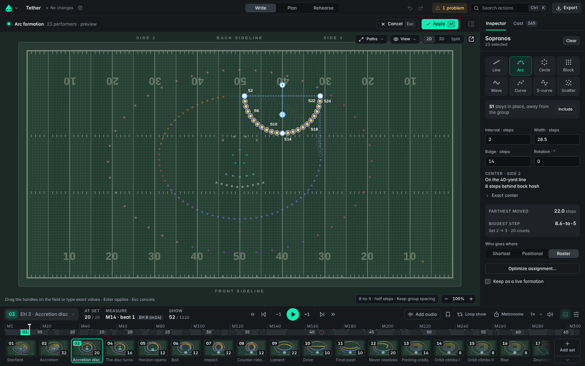
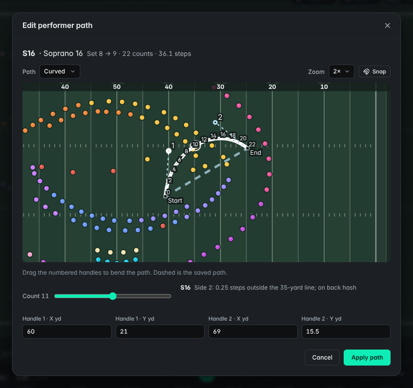
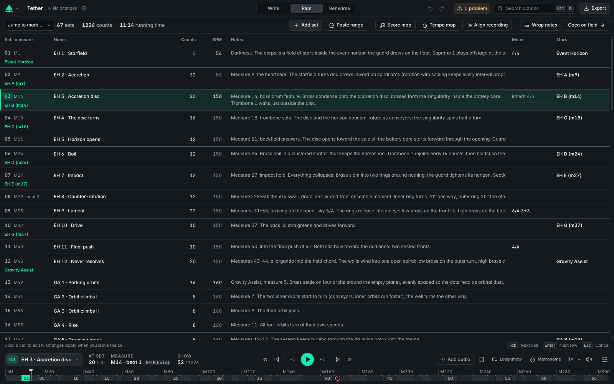
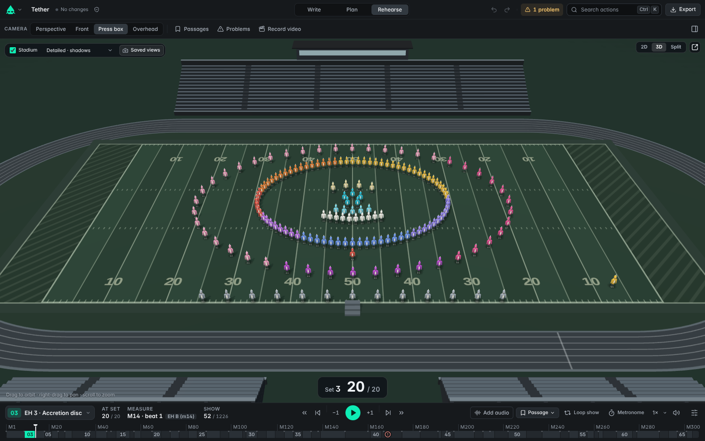

# Squidware

**Write drill the way you think about it. A desktop drill design studio for marching bands, drum corps and indoor ensembles.**

Squidware puts the field, the cast, the music and the production sheet in one window. Pick an ensemble and you are moving dots in seconds; shape forms with one click, connect sets in counts, check every move as you write, rehearse it in 3D with the recording, and hand the band a drill book. It runs on Windows, macOS and Linux, keeps your files on your computer, and is free and open source.

[Download](https://github.com/IanSzymanski/squidware/releases) · [User guide](docs/USER_GUIDE.md) · [Run from source](#run-from-source) · [Roadmap](ROADMAP.md)


## Why drill writers use it

- **It speaks drill.** Positions read as side, yard line and hash ("2.5 steps outside the 40, 6 steps behind back hash"), lengths in steps, step size as 8-to-5 style ratios, time in counts and measures. Type a position the same way: "4 outside the 40, 8 behind the front hash".
- **The first click is usable.** A new line or arc lands on a whole-step interval, sized to the section you picked, centered on a step, and numbered in Cast order along the form when that keeps paths clear. A soloist standing offstage stays put until you choose to include them.
- **Everything is one step away.** The verbs of drill writing (Line, Arc, Circle, Block, Wave, Align, Rotate, Mirror, Place) are buttons above the field, and every other command is in a palette that suggests what fits your selection. `Ctrl/⌘ K`, type "move 4 forward", Enter.
- **Problems surface while you write.** Every move is checked for spacing and step size in the background. Findings read as one line ("R11 and R12 too close · 0 steps apart · Set 40 → 41 · ct 11") with a Go button that takes you to the count and selects the performers.
- **Rehearse with the music.** The attached recording drives the show clock, with a meter-aware metronome, count-in, rehearsal passages and a full 3D stadium view.
- **Your show is yours.** No account, no subscription, no cloud. Projects are plain local files with a [published format](format/FORMAT.md), and automatic recovery copies protect work in progress. MIT licensed.

## Get on the field fast

Open Squidware and pick a starting ensemble: a small, marching or large band, a drum corps, or an indoor floor for winter guard. You land on the field with the cast in a staging block, ready to shape. Or explore **Tether**, the bundled 165-member, 67-set drum corps show written with curvilinear forms, scatters, orbiting conveyors, follow-the-leader cables, a counter-march and a company front ([about the demo](examples/README.md)). Import your own roster from CSV at any time. A production holds up to **500 performers and 128 sets**.

| To | Use |
| --- | --- |
| Pick performers | Click a section's name, drag a box, draw a lasso, select a rank or file, or recall a [saved group](docs/SELECTION_TOOLS.md). Cast and field share one selection. |
| Shape them | Preview a [line, arc, circle, block or wave](docs/FORMATION_PREVIEWS.md), an [editable Bézier curve](docs/bezier-formations.md) or a [seeded scatter](docs/scatter-formations.md). Drag the handles or type interval, width and bulge in steps, then Apply. |
| Arrange them | Rotate and scale with the frame on the field, [mirror across the 50 or front to back](docs/EXACT_TRANSFORMS.md), [align and space at an exact interval](docs/SPACING_ALIGNMENT.md), or [place by drill coordinates](docs/COORDINATE_ENTRY.md). |
| Keep a form editable | Save it as a [live formation](docs/live-formations.md) that keeps its shape and member slots, or store it in your [template library](docs/template-library.md) for the next show. |
| Add the next set | One click on **Add set** holds the current picture for the same number of counts. The arrow under it offers a repeat, a clean staging grid or an insert before. |



Every shape, transform and spacing edit previews before it changes anything. Apply records one named undo step; Cancel leaves the picture as it was. Ghosts of the previous and next sets and their paths show where each performer comes from and goes.

## Shape every move

Moves are more than straight lines. Bend one performer's path with handles and watch the count ticks along it; [draw a path freehand](docs/path-authoring.md) and fit it; give a performer [holds and timed stages](docs/movement-schedules.md) inside a move so they leave and arrive on their own counts.



| For | Squidware gives you |
| --- | --- |
| Whole-ensemble travel | [Follow-the-leader, counter-march and conveyor](docs/group-movement.md) movement along [shared routes](docs/shared-routes.md), with delays, intervals and cues. |
| Form-to-form transitions | [Controlled formation transitions](docs/formation-transitions.md) that morph one live formation into another with shared timing and checks. |
| Who goes where | Shortest-travel, positional or Cast-order assignment, and an [assignment optimizer](docs/assignment-optimization.md) that compares options with pins and section constraints. |
| Editing a move after the fact | [Move operations](docs/path-operations.md) to resize counts, reverse a move or copy intervals, and a [transition split](docs/split-transition.md) that adds a set partway through. |
| Body and equipment | [Performer facing](docs/performer-facing.md), instrument and guard markers, and [choreography cues](docs/USER_GUIDE.md#choreography-cues) such as plié and flag moves by count. |
| Props and pit | [Staging props](docs/USER_GUIDE.md#staging-props) and front ensemble equipment that move set to set, with optional footprint clearance checks. |

## Plan the whole show

**Plan** mode gives the production sheet the whole window: every set with its measure, counts, tempo, meter, rehearsal mark and notes. Type straight into the grid, or paste a range from a spreadsheet and review it before it applies. The **Score map** adds pickups, meter changes and rehearsal marks; the **Tempo map** adds tempo changes, ramps and fermatas. Playback, the metronome and every readout follow the same musical timeline.



[Recording anchors](docs/audio-alignment.md) line set arrivals and individual counts up with a variable-tempo recording, with waveform and tap assistance. See the [production sheet](docs/production-sheet.md) and [score map](docs/score-map.md) guides.

## Catch problems before rehearsal does

[Show-wide problems](docs/show-wide-problems.md) checks every move for performers that come too close and steps that are too big, including curved paths and group routes, and keeps checking as you edit. The count in the top bar, markers on the timeline and badges on set thumbnails show where to look; one click takes you to the count with the performers selected and their paths highlighted. [Rules](docs/analysis-rules.md) can differ by section and marching direction and travel with the project. Turn on footprint clearance to check performers against props and pit equipment.

## Rehearse it before the band does

Switch to **Rehearse** for a 3D stadium view with press-box, front, overhead and perspective cameras, or save your own angles. Open the 3D view in its [own window](docs/USER_GUIDE.md#3d-window) on a second display while you write. A large set-and-count readout serves the back of the room.



Attach the recording and it becomes the show clock, with a sync offset, a meter-aware metronome and a count-in. Change speed, loop the show, or save [rehearsal passages](docs/rehearsal-passages.md) for a section or a few performers. Labels step aside during playback so you see pure form in motion. Render a [rehearsal video](docs/USER_GUIDE.md#export-a-rehearsal-packet) of any set range from any camera, with the recording if you like.

## Hand the band their drill

**Export** produces what the staff and the ensemble need:

| Output | Contents |
| --- | --- |
| PDF drill book | A field chart for every set with counts, tempo and notes, on Letter or A4 |
| Performer coordinate sheets | A dot book page for every performer with their position at every set in steps |
| Coordinates CSV | Every performer at every set, with arrival descriptions and timing |
| Current chart SVG | A scalable drawing of the set on screen |
| Rehearsal video | A WebM of a set range from a chosen camera |
| Portable production | The editable show with its recording bundled or referenced, in one `.squidpack` file |


## Make it yours

Choose dark, light or high-contrast themes and a UI scale; set dot size, label size and colors on the field; turn the field to face the audience either way. Rebind any shortcut. Save named [workspaces](docs/WORKSPACES.md). Write on a football field, an [indoor floor or a custom stage](docs/USER_GUIDE.md#indoor-floors-and-custom-stages) in feet or meters, with your own floor plan as the background. The interface stays fully usable from small laptop windows to large displays, by keyboard as well as mouse.

## Get Squidware

Download the newest build for your platform from [Releases](https://github.com/IanSzymanski/squidware/releases): a portable `.exe` for Windows x64, a `.dmg` for Apple Silicon Macs, or an AppImage for Linux x64. Every release lists its changes and includes SHA-256 checksums. Builds are not code-signed yet, so the first launch may ask you to confirm the app.

### Run from source

Use **Node.js 24** and **pnpm 11.25.0**, matching the repository workflows.

```sh
git clone https://github.com/IanSzymanski/squidware.git
cd squidware
pnpm install --frozen-lockfile
pnpm exec install-electron
pnpm desktop
```

`pnpm desktop` starts the development server and Electron together on port 5173. To run a production build locally, use `pnpm build` and then `pnpm start`. `pnpm dev` runs the editor in a browser for renderer work.

## Your first show in five minutes

1. Open Squidware and pick an ensemble, or explore the demo.
2. Click a section's name in the side panel, then **Arc** in the tool strip. Adjust it on the field and press Enter to apply.
3. Click **Add set**. Drag the section somewhere new, or shape it again.
4. Press Space to watch the move. Attach your recording from the transport to play it with the music.
5. Save the project, then **Export** a drill book or dot books for the band.

The [user guide](docs/USER_GUIDE.md) walks through the full workflow, from roster import to rehearsal video.

### Keyboard essentials

Use `Ctrl` on Windows and Linux and `⌘` on macOS. Change any of these in **Preferences → Shortcuts**.

| Action | Shortcut |
| --- | --- |
| Command palette | `Ctrl/⌘ K` |
| Play / pause | `Space` |
| Previous / next set | `[` / `]` |
| Previous / next count | `,` / `.` |
| Select / pan | `V` / `H` |
| Move the selection / fast move | `Alt` + arrow / `Shift+Alt` + arrow |
| Undo / redo | `Ctrl/⌘ Z` / `Ctrl/⌘ Shift Z` |
| Save / Save As | `Ctrl/⌘ S` / `Ctrl/⌘ Shift S` |
| Open / new production | `Ctrl/⌘ O` / `Ctrl/⌘ N` |
| Toggle 2D / 3D | `T` |
| Open or focus the 3D window | `Shift+T` |

The field is one Tab stop: arrow keys move between performers, Enter or Space selects, and Shift adds to the selection. See [commands, drill phrases and rebinding](docs/COMMAND_PALETTE.md).

## Your files stay on your computer

| File | What it holds |
| --- | --- |
| `.squid` | The editable show: drill, cast, sections, timing, notes and audio offset |
| `.squidpack` | The editable show with its recording bundled or referenced |
| Recovery copies | Automatic local copies of your work, reviewable from the Project menu |
| PDF, CSV, SVG, WebM | Drill books, dot books, coordinate data, charts and rehearsal video |

The [`.squid` format](format/FORMAT.md) is public, versioned and documented with JSON Schemas, migration examples and a reference validator, and every version of Squidware opens files from earlier ones. See [audio packages](docs/AUDIO_PACKAGES.md) for `.squidpack`.

## Built to be trusted

Squidware is built with Electron, React, TypeScript and Three.js. Drill geometry, timing and validation live in a [pure engine](docs/domain.md) shared by the editor, the checks and the exports; every edit is a typed command with named undo. The desktop renderer runs isolated from Node with a fixed preload API. More than a thousand unit tests and over fifty desktop workflow suites drive the real app on Windows, macOS and Linux before a release ships.

| Path | Holds |
| --- | --- |
| `src/ui/`, `src/shell/` | The [design system](docs/DESIGN_SYSTEM.md) and the application shell ([how the interface was rebuilt](docs/UI_REBUILD.md)) |
| `src/editor/` | Editor state, commands, feature panels, playback and file sessions |
| `src/domain.ts` | Geometry, timeline, validation and data exchange |
| `src/components/` | The 2D field, the Three.js rehearsal scene and print output |
| `electron/` | The native window, file dialogs, atomic saves, packages and recovery |
| `scripts/` | Development, validation, packaging and desktop workflow tooling |

```sh
pnpm test            # unit tests
pnpm test:contracts  # format and release contracts
pnpm build           # production build
pnpm test:workflows  # desktop workflow suites
```

`pnpm certify` runs the full certification for the current OS, including packaging. See the [testing guide](docs/TESTING.md) and the [release plan](docs/RELEASES.md).

## License and contributions

Squidware is free software under the [MIT License](LICENSE), copyright © 2026 Squidware contributors. Use it, change it and share it, including commercially, keeping the license and copyright notice. Contributions are welcome under the same license. Dependencies keep their own licenses, listed in [THIRD_PARTY_NOTICES.txt](THIRD_PARTY_NOTICES.txt); desktop packages carry them in `resources/legal/`. See the [licensing guide](docs/licensing.md).

Squidware is an independent project and is not affiliated with or endorsed by Pyware or its owners.
