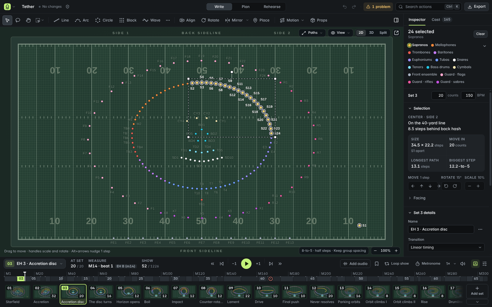
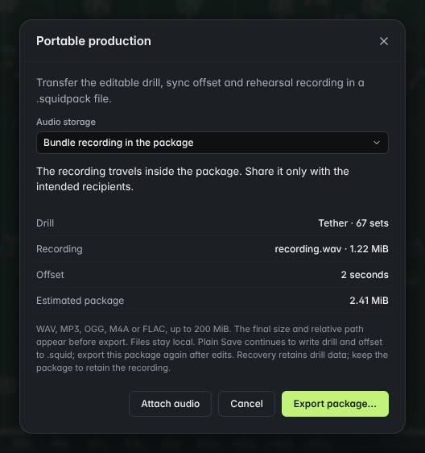

# Squidware

**Find your flow. A desktop drill design studio for marching ensembles.**

Write formations, refine transitions, rehearse in 3D, and export the next rehearsal packet. Squidware brings the cast, field, musical timeline and production sheet into one local workspace on Windows, macOS and Linux. Free, open source, and no account required.

[Download v0.6.0](https://github.com/IanSzymanski/squidware/releases/tag/v0.6.0) · [User guide](docs/USER_GUIDE.md) · [Run from source](#run-from-source) · [Roadmap](ROADMAP.md)

> **Release and development:** v0.6.0 is the newest published prerelease. This README and its screenshots show current `main`, including unreleased musical timing, editable travel paths, reusable formations and group route movement. [Run from source](#run-from-source) to use these features.



## Design with precision

Start with **Tether**, the bundled demo: a full 165-member drum corps show with 67 sets in four movements, written to Squidwriter's Space show with curvilinear forms, scatters, orbiting conveyors, follow-the-leader cables, a counter-march and a company front ([about the demo](examples/README.md)). Or create a blank production and import your cast. The field supports up to **500 performers and 128 sets**.

| Your next step | Tools in the workspace |
| --- | --- |
| Build the cast | CSV roster import, editable names and sections, and [shared selection between Cast and field](docs/CAST_PANEL.md). |
| Select the right performers | Individual and additive section selection, marquee and reviewed lasso selection, rank/file selection and [saved groups](docs/SELECTION_TOOLS.md). |
| Place the picture | Drag, configurable [grids and group snapping](docs/GRID_SNAPPING.md), keyboard nudges and [drill-language coordinate entry](docs/COORDINATE_ENTRY.md). |
| Shape and refine | Preview [lines, arcs, circles, blocks and waves](docs/FORMATION_PREVIEWS.md), editable Bézier curves and seeded scatter; [rotate, scale and mirror](docs/EXACT_TRANSFORMS.md); set [alignment and exact intervals](docs/SPACING_ALIGNMENT.md). |
| Connect the sets | Previous/next ghosts and paths, counts and tempo per move, distinct New/Duplicate/Insert/Hold actions, and a [sampled transition split](docs/split-transition.md). |

Formation, transform and spacing tools preview the result before Apply. Accepted edits use named undo actions; Cancel keeps the original picture.

The window is built around the field. A top bar holds the project, the three modes (**Write**, **Plan** and **Rehearse**), undo, problems and command search. One tool strip above the field holds the pointer tools, the shapes (Line, Arc, Circle, Block, Wave), the arrangers (Align, Rotate, Mirror, Place) and the Motion menu; while a preview is open the strip shows what is being previewed with Cancel and Apply. The side panel shows the sections, the selection in drill terms (coordinate, size in steps, counts, travel and step size) and the current set, or the Cast list. Below the field are the transport, a count timeline with problem markers, and every set as a thumbnail. Any command is one search away with `Ctrl/⌘ K`.

The layout adapts to window size and UI scale: tool groups fold into Shape and Arrange menus, the side panel opens over the field, and playback options move into **More playback options**. Preferences groups **Appearance**, **Field display**, **Editing** and **Shortcuts**, with dark, light and high-contrast themes. Display and layout choices leave drill geometry unchanged. The [design system](docs/DESIGN_SYSTEM.md) describes the shell, tokens and shared controls.

## Shape the movement

Pause at an arrival set and select one performer to **Edit performer path**. Refine a cubic curve with field handles or exact coordinates, then scrub its count ticks before Apply. **Draw performer path** and **Edit movement timing** preview on the main field with docked parameters and pinned Apply/Cancel controls. Stroke fitting, intermediate anchors, holds and timed submoves let performers depart and arrive independently.


| Build on your work | Current tools |
| --- | --- |
| Keep formations editable | [Live formations](docs/live-formations.md) retain shape parameters and member slots. Refine [Bézier curves and waves](docs/bezier-formations.md) or preview [seeded scatter](docs/scatter-formations.md) with spacing constraints. |
| Arrange your tools | Switch Write, Plan or Rehearse, and save named [personal workspaces](docs/WORKSPACES.md) from the Project menu. |
| Reuse a starting point | Save anonymous ensemble setups and formation presets in a [personal template library](docs/template-library.md), then preview placement on the current cast. |
| Compare destinations | [Optimize assignment](docs/assignment-optimization.md) compares travel and movement checks while respecting pins, section slots and explicit role constraints. |
| Control ensemble travel | Review [formation transitions](docs/formation-transitions.md), or use [shared routes](docs/shared-routes.md) for [follow-the-leader, counter-march and conveyor movement](docs/group-movement.md). Preview connectors, count ticks and spacing/stride findings before committing. |

Path and movement edits use reviewed previews and named undo actions. See [individual path authoring](docs/path-authoring.md) for drawing and handle controls, and [move operations](docs/path-operations.md) for reviewed count resizing, reversal and interval copy/paste.

## Plan the whole show

Edit set names, counts, tempos and notes in the **Production sheet**. Navigate cells with the keyboard or review a CSV/TSV paste before applying the range as one undoable edit. Add pickups, meter changes and rehearsal marks through the **Score map**; measure/beat readouts and the metronome use the same count axis. Preview [tempo ranges, linear BPM ramps and timed fermatas](docs/tempo-map.md) with one undoable Apply; playback and the metronome share the map.


Use the set strip to move between sets and reorder them by drag, and the set finder in the transport to search by number or name. The [Production sheet guide](docs/production-sheet.md) and [Score map guide](docs/score-map.md) explain editing and timing rules.

## Rehearse and review

Switch from the 2D field to an orbitable **3D preview**, with perspective, front and overhead cameras, or open it in a separate [3D window](docs/USER_GUIDE.md#3d-window) that follows the editor, for example on a second display. Scrub by count, change rehearsal speed, loop the show, or save an annotated passage for a section or selected performers. Attached audio drives the show clock, with a sync offset, meter-aware metronome and count-in. Use [recording anchors](docs/audio-alignment.md) to align set arrivals and individual counts to variable-tempo recordings, with waveform/tap assistance and an undoable preview.


[Show-wide problems](docs/show-wide-problems.md) flag minimum spacing and excessive stride and take you to the affected count and performers. Timeline markers group nearby findings so you can review them from the affected move. [Production, section and direction rules](docs/analysis-rules.md) travel with the project. Checks describe performer-center geometry; review physical clearance and traffic separately.

## Bring the recording with you

**Export** groups field charts and performer coordinate sheets under **PDF drill book**. **Other formats** offers coordinate CSV, the current chart as SVG and **Portable production with audio**. Choose the portable production to bundle the recording in a `.squidpack` file or reference it relative to the package folder. Review the contents and size before export. Opening the package restores its recording and offset; a missing or changed reference offers an explicit relink action while keeping the drill intact.



[Portable audio packages](docs/AUDIO_PACKAGES.md) support WAV, MP3, OGG, M4A and FLAC up to 200 MiB, subject to decoder support. Export the package again after edits or relinking.

## Get Squidware

The latest downloadable build is **[v0.6.0 — Precise field authoring](https://github.com/IanSzymanski/squidware/releases/tag/v0.6.0)**, a prerelease. Choose the asset for your platform:

| Platform | Download |
| --- | --- |
| Windows x64 | [Portable executable](https://github.com/IanSzymanski/squidware/releases/download/v0.6.0/Squidware.0.6.0.exe) |
| macOS Apple Silicon | [ARM64 disk image](https://github.com/IanSzymanski/squidware/releases/download/v0.6.0/Squidware-0.6.0-arm64.dmg) |
| Linux x64 | [AppImage](https://github.com/IanSzymanski/squidware/releases/download/v0.6.0/Squidware-0.6.0.AppImage) |

Packages are unsigned. The release includes [SHA-256 checksums](https://github.com/IanSzymanski/squidware/releases/download/v0.6.0/SHA256SUMS.txt). See [all releases](https://github.com/IanSzymanski/squidware/releases) for release notes and available assets; the [release plan](docs/RELEASES.md) tracks upcoming work.

### Run from source

Use **Node.js 24** and **pnpm 11.25.0**, matching the repository workflows.

```sh
git clone https://github.com/IanSzymanski/squidware.git
cd squidware
pnpm install --frozen-lockfile
pnpm exec install-electron
pnpm desktop
```

`pnpm desktop` starts the development server and Electron together. Port 5173 must be available; closing the app stops the server. To run a production build locally:

```sh
pnpm build
pnpm start
```

3D requires WebGL; the 2D editor remains available if 3D cannot initialize. For browser-only renderer development, use `pnpm dev`; the preview uses downloads and browser printing in place of native file/PDF dialogs. Portable packages use the desktop app.

## Your first rehearsal

1. Start a new production from the welcome screen (pick an ensemble size and you are on the field), or explore the demo. Choose a set and click a section in the side panel.
2. Drag the selection, or click a shape such as Arc to preview a formation. Apply it, then use Undo to compare. Keep it as a live formation to refine it later.
3. Choose **Add set** at the end of the set strip: a new picture, a duplicate, an insert or a hold. Set its counts, tempo and rehearsal notes.
4. Select one performer at an arrival set to preview a travel-path edit. Review flagged transitions, attach audio, then play or scrub in 2D or 3D.
5. Save the editable project and export field charts, performer sheets or a portable audio package.

The [user guide](docs/USER_GUIDE.md) covers the full workflow, including roster import, coordinate conventions and file handling.

### Keyboard essentials

Use `Ctrl` on Windows/Linux and `⌘` on macOS. Defaults can be changed in **Preferences → Shortcuts**.

| Action | Shortcut |
| --- | --- |
| Command palette | `Ctrl/⌘ K` |
| Play / pause | `Space` |
| Previous / next set | `[` / `]` |
| Previous / next count | `,` / `.` |
| Select / pan | `V` / `H` |
| Move the selection / fast move | `Alt` + arrow / `Shift+Alt` + arrow |
| Undo / redo | `Ctrl/⌘ Z` / `Ctrl/⌘ Shift Z` |
| Save / Save As | `Ctrl/⌘ S` / `Ctrl/⌘ Shift S` |
| Open / new production | `Ctrl/⌘ O` / `Ctrl/⌘ N` |
| Toggle 2D / 3D | `T` |
| Open or focus the 3D window (desktop) | `Shift+T` |

The field is one Tab stop: arrows move performer focus, Enter/Space selects, and Shift+Enter/Space adds or removes a performer. Editing shortcuts respect text entry. See [commands, drill phrases and rebinding](docs/COMMAND_PALETTE.md).

## Files stay local

The desktop app runs without an account or external service. Automatic recovery and explicit file saves have separate status; use Save for a lasting project copy.

| File or output | What it keeps |
| --- | --- |
| `.squid` | Editable drill, cast, sections, timing, notes and audio offset. Recording bytes and undo history are excluded. |
| `.squidpack` | Editable production plus bundled audio or a relative recording reference. Export is a snapshot and does not replace the plain Save destination. |
| Local recovery | Automatic drill recovery copies; keep the package separately for its recording. |
| PDF / CSV / SVG | Field charts and performer coordinate sheets, coordinate data, or the current field chart. |

The public [`.squid` format contract](format/FORMAT.md) includes v1–v13 JSON Schemas, migration examples, a maximum-size fixture and a reference validator. Ordinary saves use schema v2, tempo maps v3, recording alignment v4, [curved performer paths](docs/movement-paths.md) v5, and [independent holds/submoves](docs/movement-schedules.md) v6. [Live formations](docs/live-formations.md) write v7, shared routes v8, editable Bézier formations v9, seeded scatter v10, and [constrained assignment comparisons](docs/assignment-optimization.md) v11. [Controlled formation transitions](docs/formation-transitions.md) combine reusable endpoints, protected individual paths, stagger and shared movement checks using these existing formats. [Group route movement](docs/group-movement.md) adds delayed followers, counter-march cues and arc-length conveyors in v12. [Performer facing and appearance](docs/performer-facing.md) use v13. Current readers open v1–v13 projects. [Package format and path rules](docs/AUDIO_PACKAGES.md) document `.squidpack`.

## Development and verification

Squidware uses Electron, React, TypeScript and Three.js. Geometry, timing and validation share a [pure engine](docs/domain.md); the editor uses typed commands and named history transactions. The desktop renderer has Node integration disabled and a fixed preload API for native operations.

| Path | Responsibility |
| --- | --- |
| `src/ui/` | Design tokens, shared controls, dialogs, menus and icons ([design system](docs/DESIGN_SYSTEM.md); [what the rebuild changed and why](docs/UI_REBUILD.md)) |
| `src/shell/` | The application shell: top bar, tool strip, side panel, show strip and welcome |
| `src/editor/` | Editor state, commands, feature panels, playback and file sessions |
| `src/domain.ts` | Geometry, timeline, validation and data exchange |
| `src/components/` | Interactive 2D field, Three.js rehearsal scene and print output |
| `electron/` | Isolated native window, file dialogs, atomic saves, packages and recovery |
| `scripts/` | Development, validation, packaging and desktop workflow tooling |

Run the checks appropriate to a change:

```sh
pnpm test
pnpm test:contracts
pnpm build
pnpm test:native
pnpm test:workflows
```

`pnpm certify` runs the complete certification plan for the current OS, including packaging and packaged startup. See the [testing guide](docs/TESTING.md) for Python, graphical desktop/Xvfb requirements and focused suites. CI runs source/contracts once and native, desktop and package checks on Windows, macOS and Linux. The [validation policy](docs/VALIDATION_POLICY.md) defines acceptance and release requirements.

To build for the current host, run `pnpm dist --publish never`; Windows also has `pnpm dist:win --publish never`. Outputs go to `release/`. Build each target on its corresponding OS. Signing and automatic updates are not configured.

## Scope and roadmap

Squidware supports standard 100 × 53⅓-yard college/high-school fields, editable straight/cubic performer paths, independently timed holds and submoves, live formations and shared group routes. Linear or eased timing applies within individual travel intervals, and curved parameter speed can vary. Group route motion uses linear counts. The 3D figures are rehearsal markers. Per-set staging props appear in 2D, 3D, field charts and rehearsal video. [Detailed spacing/stride checks](docs/detailed-path-analysis.md) report conservative bounds and confirmed/possible findings for custom paths. Detailed split/rewire operations, proprietary Pyware interchange and cloud collaboration remain roadmap work. See [planned releases](docs/RELEASES.md) and the [implementation queue](docs/IMPLEMENTATION_QUEUE.md).

Squidware is an independent early-stage project and is not affiliated with or endorsed by Pyware or its owners.

## License and contributions

Licensed under the [MIT License](LICENSE), copyright © 2026 Squidware contributors. You may use, modify and redistribute Squidware, including commercially, while preserving the license and copyright notice. Contributions are provided under the same license; preserve attribution and identify third-party code or assets.

Dependencies retain their own licenses in [THIRD_PARTY_NOTICES.txt](THIRD_PARTY_NOTICES.txt). Desktop packages include Squidware, dependency and Chromium notices in `resources/legal/` (`Contents/Resources/legal/` on macOS); keep those files when redistributing. See the [licensing guide](docs/licensing.md).
