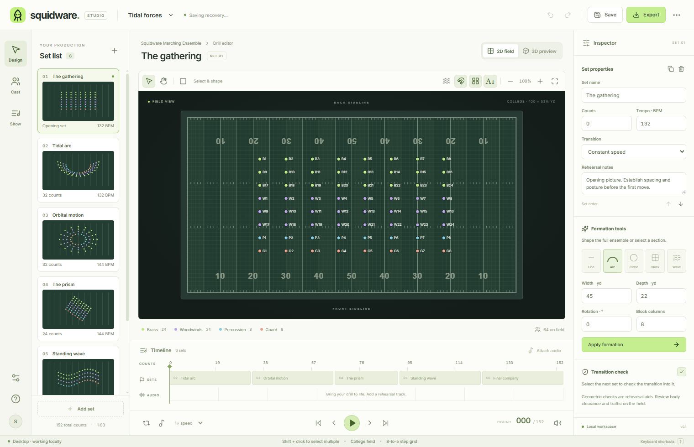

# Squidware

The public [`.squid` format contract](format/FORMAT.md) includes v1/v2 JSON Schemas, small migration examples, a 500-performer/128-picture fixture and a reference validator.

**Find your flow. A desktop drill design studio for marching ensembles.**

Squidware brings cast management, an interactive 2D field, 3D rehearsal, count-based playback, and printable drill books into one local workspace. It is built with Electron, React, TypeScript, and Three.js, with native project dialogs and no account requirement.

This is an independent early release of a Pyware-style alternative. It implements a complete basic design-to-rehearsal workflow; it does **not** claim feature parity with mature professional drill software or compatibility with proprietary Pyware files.



## What you can do

- **Design in 2D:** select individual performers or groups, marquee-select, drag, enter exact coordinates, snap to an 8-to-5 step grid, nudge, pan, zoom, and inspect paths from the previous set.
- **Shape formations:** create lines, arcs, circles, blocks, and waves; adjust width, depth, rotation, and block columns; rotate or scale a selection.
- **Rehearse in 3D:** orbit an actual WebGL field with section-colored performer markers, shadows, and perspective, front, and overhead cameras.
- **Build a production:** add, duplicate, reorder, and remove sets; assign move counts, tempo, easing, and rehearsal notes; undo and redo named actions, review session History, and cancel text/color drafts.
- **Manage the ensemble:** add performers, import a CSV roster, edit names and sections, and select sections from the field legend.
- **Play the show:** scrub the timeline, change playback speed, loop, use a metronome, and attach an audio track with a sync offset.
- **Review transitions:** inspect continuous minimum spacing and excessive stride flags, then select the affected performers on the field.
- **Take it to rehearsal:** save editable `.squid` projects; export PDF field charts, individual coordinate sheets, coordinate CSV, and the current chart as SVG.

The included **Tidal forces** demo has 64 performers across six editable sets. A blank production starts with four customizable sections and an opening set.

Download the Windows portable application, macOS Apple Silicon DMG, or Linux x64 AppImage from [release v0.1.0](https://github.com/IanSzymanski/squidware/releases/tag/v0.1.0), or run it from source below. Packages are unsigned; the Windows executable was launch-tested locally, while macOS and Linux packages were built in GitHub Actions.

## Run the desktop app

Use **Node.js 24** and **pnpm 11.25.0**, the versions used by this repository's workflows. The package manager version is recorded in `package.json`.

```sh
git clone https://github.com/IanSzymanski/squidware.git
cd squidware
pnpm install --frozen-lockfile
pnpm exec install-electron
pnpm desktop
```

`pnpm desktop` starts the local development server and the Electron window together. Close the app or stop the command to stop both processes. Port 5173 must be available.

To run the built desktop application:

```sh
pnpm build
pnpm start
```

The built app works locally without a development server. A graphics device that supports WebGL is needed for 3D; the 2D editor remains available when 3D cannot initialize.

For renderer development in a browser, use `pnpm dev`. Browser preview uses file downloads and the browser print dialog in place of native desktop save and PDF dialogs.

## Build a distributable

On Windows, build the portable executable:

```sh
pnpm dist:win --publish never
```

Artifacts are written to `release/`. `pnpm dist --publish never` builds the configured target for the current host: portable EXE on Windows, DMG on macOS, or AppImage on Linux. Build each platform on its corresponding OS; signing and automatic updates are not configured.

The [release train](.github/workflows/release-train.yml) coordinates the [release plan](docs/RELEASES.md). It invokes desktop packaging only after a release's issues are fulfilled and source CI passes. Publication checks Windows, macOS and Linux packages, checksums and immutable tags again. A configured target does not imply a platform has already been tested or released.

## Verify changes

```sh
pnpm test
pnpm test:desktop
pnpm build
pnpm exec electron . --smoke-test
pnpm test:editor
pnpm test:recovery
pnpm test:preferences
pnpm test:thumbnails
```

- Vitest covers formation geometry, transforms, project validation, timeline sampling, timing conversion, roster import, coordinate export, and transition analysis.
- The desktop tests exercise the actual main-process and preload source with controlled dialogs and temporary files, including atomic saves, canceled dialogs, invalid requests, and renderer isolation.
- The native smoke test launches Electron, checks that the renderer and preload bridge load with Node access disabled, and exits. It requires a graphical desktop; the [CI workflow](.github/workflows/ci.yml) shows the sandboxed Xvfb setup used on Linux.
- The editor workflow check runs the production renderer and actual desktop file handlers in an isolated profile with controlled dialogs. It checks boundary imports, numeric validation, undo/redo, selection, formations, playback, saves, reopening, and CSV/SVG export. Build first; artifacts go to `.qa/editor/`.
- The thumbnail check instruments the maximum production renderer and asserts one-set redraws, color/roster invalidation, selection-cache reuse, undo/redo and playback. See [the performance evidence](docs/performance.md#thumbnails-and-selection-issue-10).
- The preferences check changes personal settings through the production UI, checks unchanged project data, opens a different show, restarts four desktop processes, verifies reset and graceful quit, and checks A4/Letter PDF dimensions. See [preferences policy and evidence](docs/PREFERENCES.md).
- The recovery check opens a 500-performer, 128-set production larger than 5 MB, profiles editing during recovery, exits the desktop process, then restores and saves the exact production in a fresh process. It also checks legacy migration and selection between productions. Artifacts go to `.qa/recovery/`; see the [recovery design and evidence](docs/RECOVERY.md).

The [initial verification record](docs/VERIFICATION.md) records the checks completed for this release and their limits. Automated checks do not replace interactive review of drag selection, 3D graphics, audio devices, or printed output. See the [user guide](docs/USER_GUIDE.md) for a practical acceptance walkthrough.

## First rehearsal

1. Open the demo, select a set from the left panel, and select a section from the field legend.
2. Drag the group or apply a formation from the Inspector. Use **Undo** to compare changes.
3. Add a set and edit its **counts into the set**, tempo, and notes.
4. Switch to **3D preview**, then play or scrub the show. Check flagged transitions in the Inspector.
5. Save the production as a `.squid` file and export a rehearsal packet.

Read the [full user guide](docs/USER_GUIDE.md) for cast import, coordinate conventions, audio synchronization, and file handling.

## Keyboard shortcuts

Use `Ctrl` on Windows/Linux and `⌘` on macOS.

| Action | Shortcut |
| --- | --- |
| Play / pause | `Space` |
| Select / pan tool | `V` / `H` |
| Select all / clear selection | `Ctrl/⌘ A` / `Esc` |
| Focus a performer on the field | Arrow key |
| Move selection one 8-to-5 step | `Alt` + arrow key |
| Move selection four steps | `Shift` + `Alt` + arrow key |
| Previous / next set | `[` / `]` |
| Undo / redo | `Ctrl/⌘ Z` / `Ctrl/⌘ Shift Z` |
| Save / Save As | `Ctrl/⌘ S` / `Ctrl/⌘ Shift S` |
| Open / new project | `Ctrl/⌘ O` / `Ctrl/⌘ N` |
| Export dialog / help in desktop | `Ctrl/⌘ P` / `F1` |

Editing shortcuts do not change a formation while typing into a form field. Tab enters and leaves the 2D field in one stop. Arrows change performer focus; Enter/Space selects, and Shift+Enter/Space adds or removes that performer. Page Up/Down walks the roster, including overlapping dots; Home/End reaches the first/last performer.

## Files and architecture

`.squid` files are UTF-8 JSON with `schemaVersion: 2`, project metadata, field settings, sections, performers, complete pictures for every set, adjacent moves with timing and supported performer paths, notes, and an audio offset. Existing v1 files migrate when opened; saves write v2. Unsupported newer formats require an updated app. Files contain no embedded audio, undo history, or cloud references and are limited to 10 MiB of UTF-8 data. The renderer and native file handlers validate with the same [versioned codec and migration contract](docs/schema-v2.md).

Coordinates use yards: `x = 0` at the left goal line and `y = 0` at the back sideline. The standard field is 100 × 53⅓ yards, excluding end zones. The [engine contract](docs/domain.md) describes schema limits, timing, coordinate conventions, and transition calculations.

| Path | Responsibility |
| --- | --- |
| `src/App.tsx` | Editor store initialization and provider |
| `src/editor/` | Selector subscriptions, typed commands, workspace/dialog components, playback and file controllers |
| `src/domain.ts` | Pure drill geometry, timeline, validation, and data exchange |
| `src/components/Field2D.tsx` | Interactive field and reusable SVG drawing |
| `src/components/Stage3D.tsx` | Three.js scene and camera controls |
| `src/components/PrintOutput.tsx` | Field chart and performer print layouts |
| `src/useProject.ts` | Project/history subscriptions and recovery initialization |
| `electron/` | Isolated desktop window, native dialogs, saves, and PDF export |
| `scripts/` | Desktop development runner and native-boundary tests |

The desktop renderer has Node integration disabled and a small, fixed preload API. Production content does not require external network connections. Recovery uses local app storage; **Save** creates the portable file you can back up and share.

## Current scope

The editor supports up to 500 performers and 128 sets, straight travel between sets with constant-speed or eased timing, and standard college/high-school football markings. This release accepts only the standard 100 × 53⅓-yard field. Transition flags model performer centers, not instrument dimensions or marching technique. The figures in 3D are rehearsal markers, not uniform or instrument simulations.

Audio attachments last for the current session and must be reattached after reopening. There is no proprietary Pyware import/export, curved individual travel paths, performer assignment optimization, props editor, video export, multiplayer editing, or cloud synchronization in this release. The current roadmap is explicit about these gaps: [ROADMAP.md](ROADMAP.md).

Squidware is not affiliated with or endorsed by Pyware or its owners.

## License and contributions

Squidware is licensed under the [MIT License](LICENSE), copyright © 2026 Squidware contributors. You may use, modify, and redistribute it, including commercially, while preserving the copyright and license notice. Contributions submitted for inclusion in Squidware are provided under the same MIT license; preserve existing attribution and identify any third-party code or assets you add.

Dependencies retain their own licenses, recorded in [THIRD_PARTY_NOTICES.txt](THIRD_PARTY_NOTICES.txt). Desktop packages include the Squidware license, runtime dependency notices, and Electron's full Chromium notices in `resources/legal/` (`Contents/Resources/legal/` on macOS). Keep those files when redistributing a package.

`private: true` in `package.json` prevents accidental publication to the npm registry; source licensing and desktop distribution use MIT regardless of that flag. See the [licensing decision and notice update guide](docs/licensing.md) for distribution details.

Named history uses reversible patches and commit/cancel boundaries; the [history contract](docs/history.md) explains field behavior, revision identity and retention limits.
