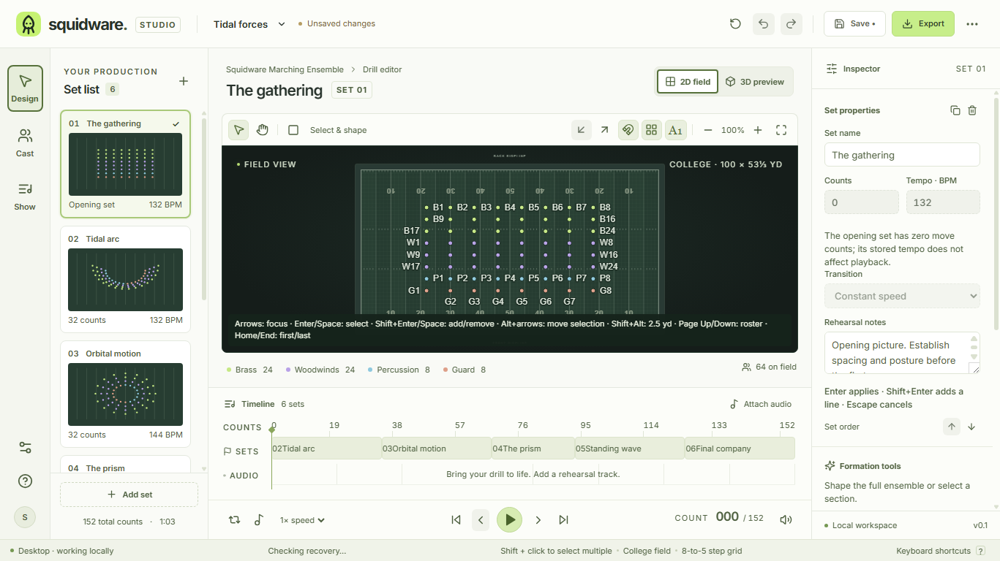
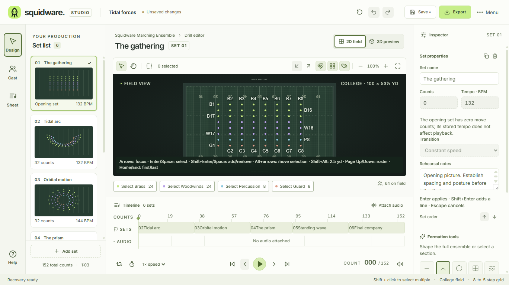

# Action labels and control inventory

Implements the product changes in [#36](https://github.com/IanSzymanski/squidware/issues/36). The first-time reviewer discovery check in that issue is still pending; automated interaction evidence does not replace it.

## Controls

| Action or workspace | Location and visible label | Glyph / behavior |
| --- | --- | --- |
| New production | **Project menu → New production…**; native File menu; the welcome dialog's starters | Lucide FilePlus2; dialog heading **New production** |
| Production settings | **Project menu → Production settings…**, or the production title in the top bar | Settings2 |
| Personal preferences | **Project menu → Preferences…** | SlidersHorizontal; personal settings remain separate from production data |
| Help and shortcuts | **Project menu → Help and shortcuts**; native **Squidware Help / F1** | CircleHelp; dialog heading **Help**; standard macOS About remains in the application menu |
| Export | **Export** in the top bar in every mode; also **Project menu → Export…** | Download; dialog heading **Export** |
| History | **Project menu → History…** | Lucide History (a clock on a counter-clockwise arrow), distinct from the Undo2/Redo2 arrows; dialog heading **History**. Its Undo/Redo buttons name the action and explain why they are unavailable. **Project menu → Recovery copies…** uses LifeBuoy |
| Cast | **Cast** tab of the side panel | Tab label with the performer count |
| Production sheet | **Plan** mode in the top bar | Text mode button; the sheet's accessible name is **Editable production sheet** |
| Add set | Labeled button at the end of the set strip; an icon button in the transport when the strip is hidden | Plus; opens the **Add set** dialog |
| Select all | Inspector header and the tool strip's **Select menu** | The Inspector header shows **Select all** with nothing selected and **Clear** (**Clear selection**) otherwise; the Select menu lists both |
| Previous / next paths | **Travel paths** menu over the field: **Show paths from previous set** and **Show paths to next set** | Custom path glyphs; existing distinct ghosts and path styles retained |
| Performer labels | **View options** menu over the field | Tags; **Show labels**, **Selected only** and **Hide labels**; the J shortcut still cycles them |
| Attach or replace audio | Transport | AudioLines; metronome uses Timer, mute retains Volume2 / VolumeX |
| Select section | Button chips at the top of the Inspector, **Select all Brass** etc.; also listed in the **Select menu** | Section-color dot, name and performer count; with a selection the chips fold to their colors until **Show section names**; same selection command behavior as before |
| Arc formation | Tool strip | Custom glyph drawn as performers in the formation, using currentColor |

Redundant Settings and Help routes, the avatar, repeated local-workspace notices, duplicate production-sheet Export buttons and promotional copy are removed. Explicit file status, Save, Undo, Export and recovery status/access stay available. The geometric rehearsal disclaimer is in Help. Contextual keyboard instructions and invalid-draft feedback remain available where they are needed.

## Introductory hint

The status bar and its retiring selection hint are gone. One hint line at the field's lower left follows the editor's state: with nothing selected it says to select a dot, a box or a section, and with a selection it names the drag and the nudge. It does not retire; turn it off with **Show hints** in Preferences. The additive, validated `selectionHintDismissed` version-1 personal preference is still recorded when performers are first selected and still resets with Reset defaults, but it no longer hides anything. No production schema, coordinates, history, recovery content or export format changes are required.

## Validation and design evidence

Applies [design guidance](DESIGN_GUIDANCE.md) sections 1–5 to this bounded control cleanup: existing React controls, Lucide library, tooltips, shortcut metadata, selection cache, colors, typography, focus outlines and preference persistence are reused. Full compact workspace layout and additional themes remain with #16/#40/#43. The existing field-height gap relative to the approximately 470 px target remains #16; this change does not claim to resolve it.

- The existing **editor** desktop suite inventories rendered controls and distinguishes audited icons. Native Return activates Menu actions, settings, preferences and Export. Pointer and Tab/Return activate section chips and expose pressed state; full selection changes the toolbar action to Clear selection. Both rail and native Help open the same dialog. Existing edit, undo, file-save, draft, preview and reopen checks use the consolidated settings path.
- The existing **preferences** suite selects performers, clears selection and restarts the application to verify hint retirement. It checks that personal changes preserve project contents/revision and reset behavior. Existing **thumbnails** and **playback** checks guard shared selection membership and idle-shell performance.
- The existing **accessibility** suite traverses the new settings route by keyboard, audits rendered text and exercises native save/export with 500 performers, including 125% UI zoom. **Tooltips** checks preserve focus/hover explanations, unavailable states, platform keycaps and 3D fallback handling.
- Source, format/release contracts, native tests, TypeScript, dependency notices and production build retain their existing owners. Hosted Windows/macOS/Linux results are recorded in the PR.
- Screenshots below were inspected at 1366 × 768, 1120 × 768 and 125% UI zoom using the production renderer. The enlarged layout retains its existing vertical page scrolling; keyboard focus scrolls required controls into view. The current supported theme is preserved.

| Before, 1366 × 768 | After, 1366 × 768 |
| --- | --- |
|  |  |

Additional evidence: [Menu](evidence/action-clarity/menu.png), [Cast](evidence/action-clarity/cast.png), [Production sheet](evidence/action-clarity/production.png), [1120 × 768](evidence/action-clarity/narrow.png), [125% UI zoom](evidence/action-clarity/enlarged.png).

## Remaining human validation

A first-time reviewer should locate Production settings, Help, section selection and Export without coaching, then report any ambiguous labels or icons. Leave #36 open until this issue-specific check is recorded. Broader writer/device validation and representative school hardware remain #64/#3.
