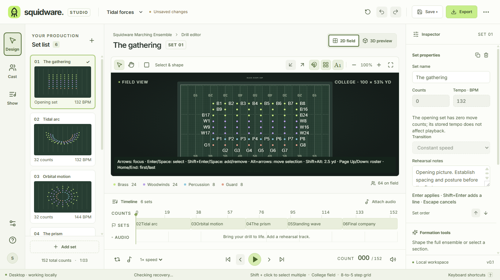
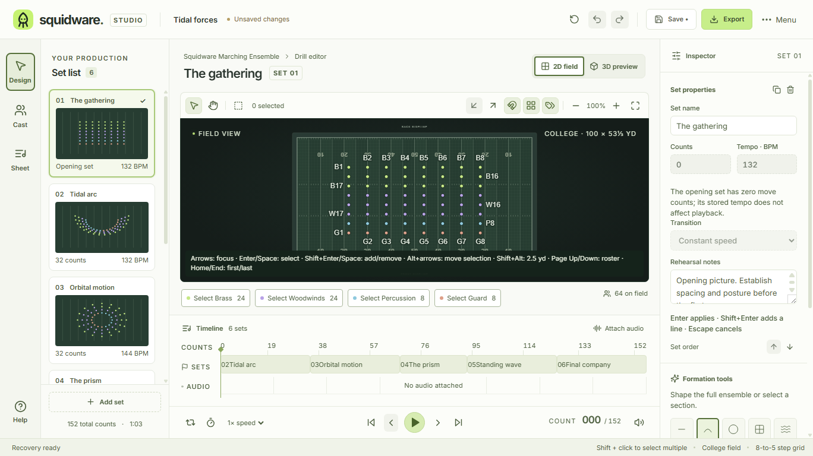

# Action labels and control inventory

Implements the product changes in [#36](https://github.com/IanSzymanski/squidware/issues/36). The first-time reviewer discovery check in that issue is still pending; automated interaction evidence does not replace it.

## Controls

| Action or workspace | Location and visible label | Glyph / behavior |
| --- | --- | --- |
| New production | Header **Menu → New production**; native File menu | Lucide FilePlus2; dialog heading **New production** |
| Production settings | Header **Menu → Production settings** | Settings2; the title is now a plain production name |
| Personal preferences | Header **Menu → Preferences** | SlidersHorizontal; personal settings remain separate from production data |
| Help and shortcuts | Labeled **Help** at the bottom of the workspace rail; native **Squidware Help / F1** | CircleHelp; dialog heading **Help**; standard macOS About remains in the application menu |
| Export | Header **Export** in every workspace | Download; dialog heading **Export** |
| Cast | Workspace rail **Cast** | Users; workspace heading **Cast** |
| Production sheet | Workspace rail **Sheet**, accessible name **Production sheet** | ListMusic; workspace heading **Production sheet** |
| Add set | Labeled button below the set list | Plus; header duplicate removed; the empty timeline points here without adding another button |
| Select all | Field toolbar | SquareDashed; full selection changes the effect, accessible name, glyph and command shortcut to **Clear selection / X / Escape** |
| Previous / next paths | Independent field toolbar controls | ArrowDownLeft / ArrowUpRight; existing distinct ghosts and path styles retained |
| Performer labels | Field toolbar | Tags; existing all / selected or focused / hidden cycle retained |
| Attach or replace audio | Timeline heading | AudioLines; metronome uses Timer, mute retains Volume2 / VolumeX |
| Select section | Button chips below the field, **Select Brass** etc. | Section-color dot, performer count, border/background, pressed state and selected checkmark; same selection command behavior as before |
| Arc formation | Formation tools | Custom 24 × 24 SVG, currentColor, rounded strokes; replaces the font-dependent arc character and uses the same grid as Lucide |

Redundant Settings and Help routes, the avatar, repeated local-workspace notices, duplicate production-sheet Export buttons and promotional copy are removed. Explicit file status, Save, Undo, Export and recovery status/access stay available. The geometric rehearsal disclaimer is in Help. Contextual keyboard instructions and invalid-draft feedback remain available where they are needed.

## Introductory hint

Selecting performers retires the status-bar selection hint. Clearing selection, changing productions and restarting do not restore it. The additive, validated `selectionHintDismissed` version-1 personal preference defaults to false in older files; Reset defaults restores it. A retained selection during reset does not immediately dismiss it again. No production schema, coordinates, history, recovery content or export format changes are required.

## Validation and design evidence

Applies [design guidance](DESIGN_GUIDANCE.md) sections 1–5 to this bounded control cleanup: existing React controls, Lucide library, tooltips, shortcut metadata, selection cache, colors, typography, focus outlines and preference persistence are reused. Full compact workspace layout and additional themes remain with #16/#40/#43. The existing field-height gap relative to the approximately 470 px target remains #16; this change does not claim to resolve it.

- The existing **editor** desktop suite inventories rendered controls and distinguishes audited icons. Native Return activates Menu actions, settings, preferences and Export. Pointer and Tab/Return activate section chips and expose pressed state; full selection changes the toolbar action to Clear selection. Both rail and native Help open the same dialog. Existing edit, undo, file-save, draft, preview and reopen checks use the consolidated settings path.
- The existing **preferences** suite selects performers, clears selection and restarts the application to verify hint retirement. It checks that personal changes preserve project contents/revision and reset behavior. Existing **thumbnails** and **playback** checks guard shared selection membership and idle-shell performance.
- The existing **accessibility** suite traverses the new settings route by keyboard, audits rendered text and exercises native save/export with 500 performers, including 125% UI zoom. **Tooltips** checks preserve focus/hover explanations, unavailable states, platform keycaps and 3D fallback handling.
- Source, format/release contracts, native tests, TypeScript, dependency notices and production build retain their existing owners. Hosted Windows/macOS/Linux results are recorded in the PR.
- Screenshots below were inspected at 1366 × 768, 1120 × 768 and 125% UI zoom using the production renderer. The enlarged layout retains its existing vertical page scrolling; keyboard focus scrolls required controls into view. The current supported theme is preserved.

| Before, 1366 × 768 | After, 1366 × 768 |
| --- | --- |
|  |  |

Additional evidence: [Menu](evidence/action-clarity/menu.png), [Cast](evidence/action-clarity/cast.png), [Production sheet](evidence/action-clarity/production.png), [1120 × 768](evidence/action-clarity/narrow.png), [125% UI zoom](evidence/action-clarity/enlarged.png).

## Remaining human validation

A first-time reviewer should locate Production settings, Help, section selection and Export without coaching, then report any ambiguous labels or icons. Leave #36 open until this issue-specific check is recorded. Broader writer/device validation and representative school hardware remain #64/#3.
