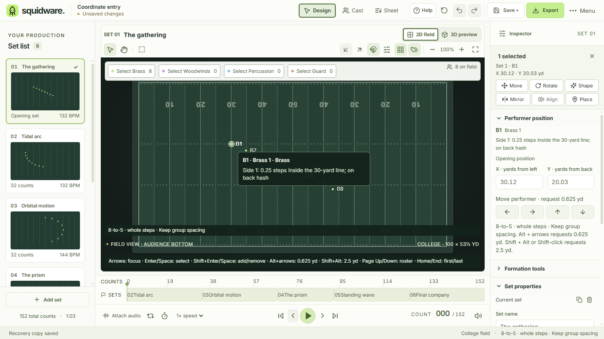
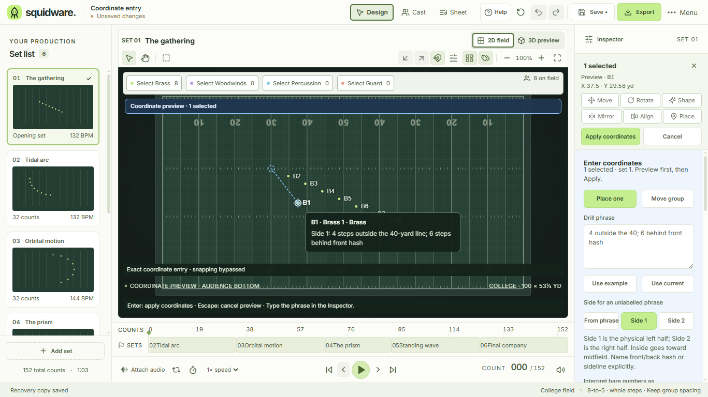

# Drill-language coordinates and exact group moves

Implements [#22](https://github.com/IanSzymanski/squidware/issues/22). Select performers and choose **Place** in the selection bar. The inline Inspector accepts an absolute position for one performer or a relative move for the explicit selection. Dashed paths and target crosshairs show the proposed coordinates. Apply/Cancel stay above the independently scrolling form.

## Supported phrases

| Mode | Example | Interpretation |
| --- | --- | --- |
| Absolute | `Side 1: 4 outside the 40; 6 behind front hash` | Use the visible bare-number unit and production step size. Both axes are required. |
| Absolute | `Side 2: 2 steps inside the 35-yard line; on back hash` | Side 2 is the physical right half. Inside goes toward midfield. |
| Absolute | `on the 50-yard line; on front sideline` | Midfield needs no side. Goal-line and other yard-line references require one. |
| Absolute | `Side 1: on the goal line; 1.25 yards in front of back hash` | Explicit yard/step units take precedence over the bare-number setting. |
| Relative | `3 steps forward` | Translate toward the physical front sideline. |
| Relative | `3 steps forward, 1.5 yards right` | Translate the selection by one common two-axis delta. |
| Relative | `2 yards toward Side 1 and 1 step toward back sideline` | Explicit field directions; independent of audience orientation and performer facing. |

The parser is case-insensitive and normalizes whitespace. Use nonnegative decimal numbers, including `0.5` or `.25`. Absolute axes are separated by one comma or semicolon, horizontal first. Relative moves support one direction per axis and at most two clauses, separated by comma, semicolon or `and`. `front`/`forward` and `back`/`backward` are synonyms; `left`/`right` mean toward Side 1/Side 2. Supported references are yard lines from 0–50, goal line, and explicitly front/back hash or sideline. Entry is limited to 240 characters. Expressions, English number words, fractions written with `/`, unnamed hashes, unspecified axes and arbitrary trailing words are unsupported and receive an error.

Side can come from `Side 1:`/`Side 2:` in the phrase or from an explicit Inspector choice. A conflicting choice is rejected. The parser never infers a side from the performer's current position. `inside the 50` with positive distance would contradict its stated side and is rejected; express the target using its destination side and `outside the 50`.

Bare-number units are explicitly shown as Steps, Yards or Require units. The UI starts with Steps selected. The standalone parser requires its caller to supply this convention or requires units in the phrase. Steps use the production's full 6-, 8- or 12-to-5 marching step, independently of grid subdivision. Thus three steps forward are 2.5, 1.875 or 1.25 yards respectively. College hashes are 20 yards from each sideline; school hashes are 160/9 yards from each sideline, using the shared formatter references.

## Preview, keyboard and history

Typing updates the parsed preview without changing project geometry, history, recovery or file-save state. Incomplete or ambiguous text clears the previous proposed geometry and cannot Apply. Invalid input explains the missing side, unit, reference or syntax. **Use example** inserts the documented example; **Use current** formats the singleton's committed coordinates at the chosen output precision and entry step basis. Rounding in Use current can propose a rounded position, which remains subject to explicit Apply.

Tab navigates the shared buttons and input. Enter in a valid changed phrase focuses Apply; a subsequent Enter activates that button. Enter on the field accepts a valid preview. Escape in the phrase, on the field or on a non-input preview control cancels the session. Ordinary tooltip dismissal retains its established behavior. The input supports Shift+Enter line breaks, normalized as whitespace. Its shared descriptive tooltip permits pointer clicks through the popup and closes when the pointer leaves the input, keeping adjacent example/current controls usable while the phrase has keyboard focus. Other tooltips retain their hover behavior, including linked help.

One Apply edits only selected performers on the captured set and creates one named undo entry. Relative moves preserve every selected offset. No empty selection falls back to the ensemble; absolute placement requires exactly one performer. Other performers, sets, identities, sections and move-path metadata remain unchanged. Undo/redo and native save/reopen preserve accepted geometry.

Exact entry bypasses snapping, as stated on the field. Boundary-crossing requests reject the whole result without snapping, clamping or shortening a delta. Only floating-point noise within 1e-8 yard at an edge is normalized. Negative or nonfinite amounts are invalid; choose the opposite direction instead of a negative amount. Zero-distance/no-op results cannot Apply.

Selection, arrival set/count, playback, view/workspace, dialog, project revision/load and history transactions invalidate the session synchronously. Other positional commands and production snapping changes are disabled during a preview. Pending unrelated text/numeric drafts block Apply and are preserved by Cancel. Audience orientation changes presentation while preserving physical input direction and coordinates.

## Formatting and compatibility

Entry formatting and parsing share yard-line/hash references and precision rules. Whole, half, quarter and decimal step output round trips within half the selected increment in the chosen entry step basis. Typed input itself is not rounded to output precision. Target/delta yard summaries are displayed to six decimal places while Apply uses the unrounded parsed result.

Entry controls show their production step size. Existing field/Cast readouts, printed coordinate sheets and CSV retain the documented 8-to-5 rehearsal convention. Coordinates remain yards in schema v2; entry text, mode, choices and guides are transient and do not enter a project file. Saving during a preview writes committed geometry, as for other exact previews.

The pure `parseDrillCoordinate`, `parseDrillMove`, `formatDrillCoordinate` and `previewCoordinateEntry` APIs support reuse. Typed `coordinates.preview` accepts optional mode, text, side and defaultUnit arguments; `coordinates.update`, `coordinates.apply` and `coordinates.cancel` use the same validated session boundary. A later command palette can invoke these commands rather than add another parser or edit path.

## Design and validation evidence

Applies [shared design guidance](DESIGN_GUIDANCE.md) sections 1–5. Reuses the contextual Inspector, Lucide MapPin, shared buttons/help, original field transforms, edit locks and named history. The Place action fits alongside the existing five actions in two rows. The field retains 485 CSS px at 1366×768/default scale and 305.4 CSS px at 1120×768/125%; entry, unit choices and Apply/Cancel remain reachable. [Measurements](evidence/coordinate-entry/results.json) record all four window/scale combinations. The light theme is currently supported; additional themes and broader writer/device qualification remain #43/#64/#3.

The 36 new source tests cover supported grammar, ambiguous/incomplete/trailing input, both sides, goal/midfield/hash references, alternate step sizes, thousands of precision round trips, exact group offsets, 500 performers, field bounds, pending/stale previews, named undo and serialized compatibility. The existing coordinate-output tests retain their 8-to-5 expectations. Local checks passed 395 source, 17 contract and 51 native-boundary/harness tests. The native coordinate-entry owner covers real pointer/Tab/Enter input, side/unit choices, preview saves, invalid/boundary input, orientation, stale membership, laptop/enlarged/narrow layouts and singleton/group undo and native save/reopen. It is registered in the shared platform certification plan; final hosted results are recorded in the PR.

The pan-test synchronization repair from the #134 post-merge macOS failure was merged separately in [PR #135](https://github.com/IanSzymanski/squidware/pull/135) after all required platform checks passed. It retains the existing movement assertion, waits for observed native gesture stages and never replays a failed gesture.

| Before entry | Absolute position preview |
| --- | --- |
|  |  |

Also inspected: [relative move](evidence/coordinate-entry/coordinate-relative.png), [missing-side error](evidence/coordinate-entry/coordinate-side-error.png), [boundary rejection](evidence/coordinate-entry/coordinate-boundary.png), [flipped orientation](evidence/coordinate-entry/coordinate-flipped.png), [narrow/125%](evidence/coordinate-entry/coordinate-1120-1.25.png), and [reachable enlarged unit controls](evidence/coordinate-entry/coordinate-units-enlarged.png).
