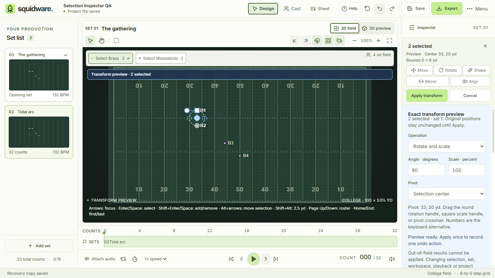

# Exact rotation, scaling, mirrors and pivots

Implements [#27](https://github.com/IanSzymanski/squidware/issues/27) on the selection workspace from #18. **Rotate** and **Mirror** open a temporary field preview. The selection bar keeps **Apply transform** and **Cancel** visible while the numeric panel scrolls independently.

## Geometry and controls

- Positive angles rotate clockwise in the existing X-right/Y-front field convention. Angles support −3600° to 3600°; scale supports 1%–10000%, where 100% preserves size. Enter or blur a valid numeric field to update the preview.
- Rotation and scaling share one affine-point implementation with the existing transform engine. Both typed controls and handles update the same typed preview parameters.
- Pivots are the arithmetic selection center, any performer on the current set, an exact custom point, or a field reference. Field references include midfield center, the 50/back or front hash intersection, and each corner. Custom points must be finite and inside the field.
- The round handle rotates; the square handle scales; dragging the crosshair chooses a custom pivot. Handles use the live SVG coordinate transform, including pan, field zoom and display zoom. Pointer values resolve to six decimal places. Numeric controls provide the keyboard alternative; handles do not add field Tab stops.
- Mirror across the 50 maps `x` to `field.width - x`, preserving Y. Front/back flip maps `y` to `field.height - y`, preserving X. These fixed field axes do not use the rotation pivot. Performer IDs, roster order and all unselected positions stay intact.
- The previous ±15° and ±10% controls now start the same preview with those parameters. A singleton can rotate around a non-origin pivot; rotation around its own center is a no-op.

## Preview, validation and history

Dashed outlines show original selected positions. Previewed dots and the selection summary show the proposed coordinates. Project positions, revisions, history, recovery and exports keep committed geometry until Apply. A numeric input still uses the existing incomplete-draft validation and save guard; Cancel removes that transform draft without resetting unrelated set or formation drafts.

Exact tools do not shift or shrink out-of-field results to fit. Such previews show a boundary error and cannot be applied. Only floating-point noise within `1e-8` yd is normalized at an edge. Invalid numbers, missing pivots and unknown selections cannot be committed. Existing translation nudges retain their group-stops-at-the-edge policy.

One Apply commits the entire preview to the explicit selection/current set as one named undo entry. Releasing a handle leaves a preview to Apply or Cancel; Escape during a drag restores that gesture's starting parameters. Escape from the field or a non-input control cancels the whole preview and preserves selection. In text/numeric inputs, Escape retains the established field-draft cancellation behavior.

The preview captures the set ID, project revision and selection. Selection/set changes, playback/scrubbing, a different view/workspace, opening a dialog or any project revision change invalidate it synchronously. Other positional commands are disabled during preview. Apply validates the current session again and rejects pending numeric drafts or no-op geometry. Transient preview state never enters personal preferences or the `.squid` schema.

A pending history transaction also invalidates the preview; a modal or unfinished input cannot start one. This keeps the accepted transform's named undo action separate from unrelated edits.

## Review evidence

Applies [shared design guidance](DESIGN_GUIDANCE.md) sections 1–5. Reuses the compact Inspector, Lucide controls, NumberField, Tooltip, command registry, named history, existing selection membership and field coordinates. Field height is preserved because the additional controls live in the Inspector. Light is the currently supported theme; #43 owns additional themes. Writer/assistive-technology and school-device validation remain #64/#3.

Source tests own inverse transforms, double mirrors, field/hash pivots, malformed inputs, exact boundary rejection, selected-only/current-set edits, stale-session invalidation and history/save-state invariants. The editor desktop owner compares known typed coordinates with real rotation/scale/pivot gestures, including field zoom; verifies cancel, Apply, undo, saved geometry, mirror identity, singleton pivots and boundary/error states; and captures default, 125%, narrow and narrow/125% layouts. The accessibility, tooltip and playback owners retain their separate contracts. Hosted results are recorded with the implementation PR.

Local Windows checks passed: production build, 240 source tests, 41 native/harness tests, 16 contract tests, and editor, accessibility, playback, tooltips, tooltips-fallback and field desktop suites. Pointer checks include scale at 160% field zoom and moving a pivot after panning. The full field suite retains dense-dot, touch, neighbor-overlay, 2× DPI and display-zoom checks. [Layout measurements](evidence/exact-transforms/transform-layouts.json) record no clipped Apply/Cancel or core file/history actions at 1366/1120 × 768 and 100/125% display zoom.

Tooltip dismissal listeners now attach with the visible tooltip layout. This prevents a fast Escape from also dismissing the underlying Help dialog; the existing tooltip owner verifies the two separate dismissals.

| Before | Exact rotation preview |
| --- | --- |
|  |  |

Additional inspected evidence: [field pivot after pan](evidence/exact-transforms/transform-field-pivot.png), [mirror](evidence/exact-transforms/transform-mirror.png), [boundary rejection](evidence/exact-transforms/transform-boundary.png), [125%](evidence/exact-transforms/transform-1366-1.25.png), [1120 px](evidence/exact-transforms/transform-1120-1.png), [narrow at 125%](evidence/exact-transforms/transform-1120-1.25.png).
