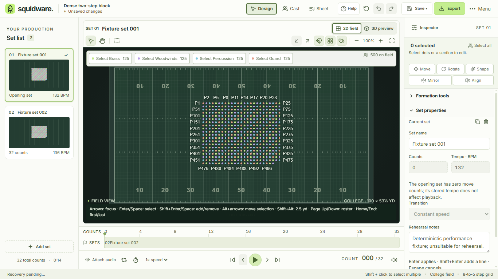
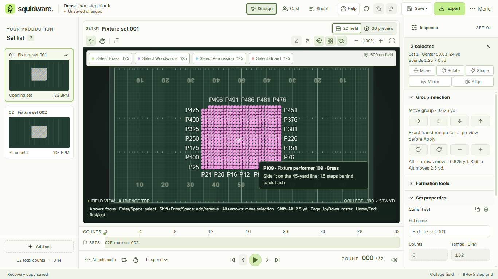
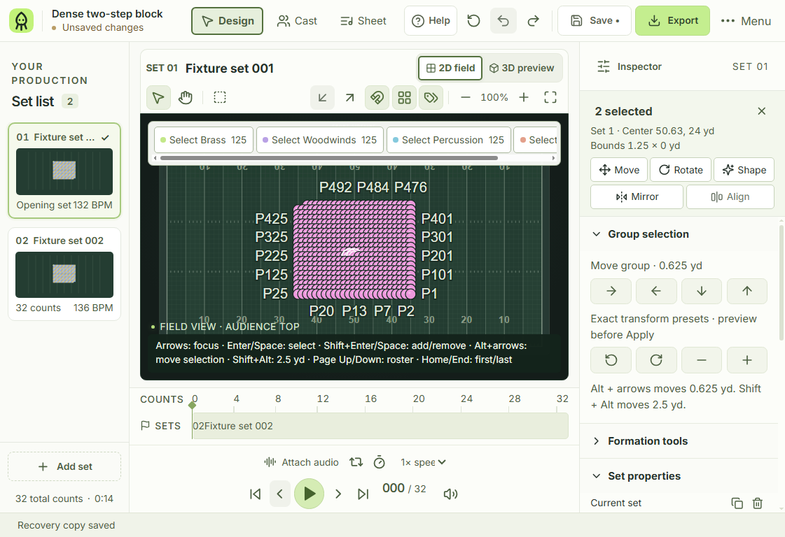
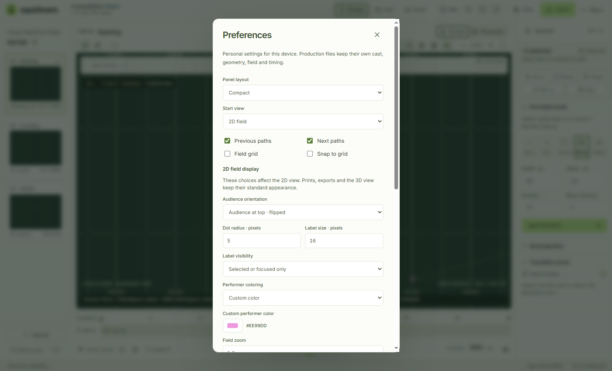
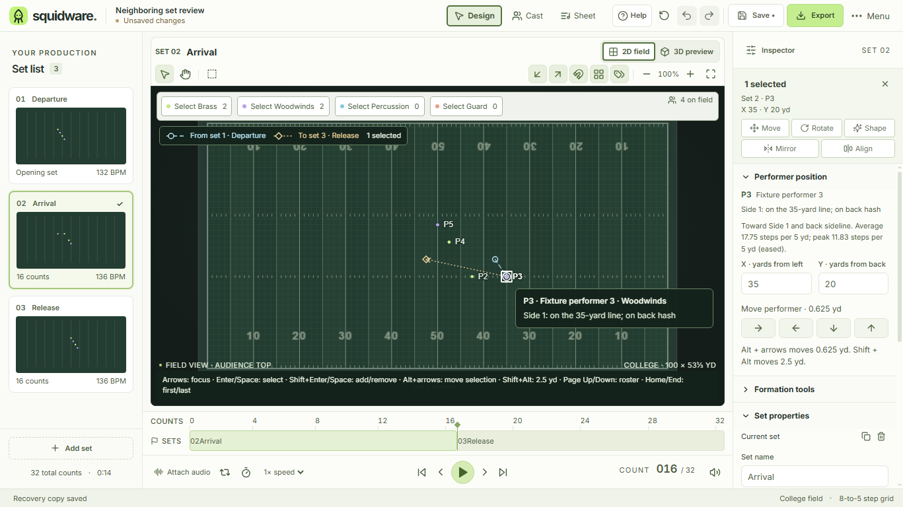

# Personal 2D field display

Open **Project menu → Preferences → 2D field display**. The changes save on this device and do not edit or dirty the production. The label toolbar button cycles the same saved label visibility choice.

| Choice | Default | Range / behavior |
| --- | --- | --- |
| Audience orientation | Bottom | Top turns the complete field view 180°. The audience position stays visible in the field status. |
| Dot radius | 3 CSS px | 2–8 CSS px, independent of field zoom and device pixel ratio |
| Label size | 12 CSS px | 11–24 CSS px; labels stay upright after flipping |
| Label visibility | All | All, selected/focused, or hidden; collisions suppress labels in all visible modes |
| Performer coloring | Section | Production section colors, current selection versus remaining performers, or one custom display color |
| Custom color | `#B9ED85` | Six-digit RGB; production section colors remain intact |

“Selection groups” means the current selected group versus everyone else. Saved named groups remain owned by #33. A white outer selection ring and a square keyboard focus outline distinguish state independently of dot coloring. Large user-selected dots can overlap in dense forms; the nearest-dot hit policy and tie cycling still apply. Defaults remain the validated 6-pixel diameter and 12-pixel label size.

## Coordinate and export policy

The orientation is a presentation half-turn around the field center. SVG geometry, neighboring paths/ghosts, marquee, pointer hit tests, coordinate readouts and transform handles use the same field group matrix. Labels counter-rotate and use screen-space collision layout. The coordinate model, performer identities and drill-language descriptions always retain their original field meaning.

Dragging, spatial focus arrows and Alt+arrow movement follow screen direction in either orientation. Roster Home/End/Page stepping retains roster order. Inspector directions and exact X/Y inputs retain physical field meaning; movement arrow icons turn with the displayed orientation. Pan and zoom work in screen/view space; switching orientation resets pan and cancels any active field gesture without committing it. Opening Preferences also cancels an exact-transform preview through the existing context invalidation policy.

Printed charts and SVG exports keep their standard audience-bottom orientation, section colors, chart dot/label geometry and full labels. CSV and project output retain canonical coordinates. The 3D view retains its own camera controls. No new project fields, schema version or print-display option are introduced.

The existing version-1 personal preferences codec fills missing fields for older records. It validates bounded finite pixel sizes, orientation/color enums, label booleans and six-digit RGB colors. Reset and storage-failure behavior remain shared with the existing [preference controller](PREFERENCES.md).

## Design and validation evidence

Applies [design guidance](DESIGN_GUIDANCE.md) sections 1–5. Reuses Preferences, NumberField, Tooltip, the shared label toolbar setting, field keyboard navigation and selection outlines. Display controls stay in the existing scrollable modal; field, header and timeline dimensions are unchanged (485 px field height at 1366 × 768/default scale). Label visibility replaces the redundant labels checkbox in Preferences. Light is the currently supported theme; theme switching remains #43.

Windows production validation: build; 243 source tests, 41 native/harness tests and 16 format/release contract tests. Desktop field, preferences, editor, accessibility, playback and tooltips suites pass across targeted runs. Native input checks flipped nearest selection/hover, spatial versus roster focus, field/global nudges, current-set drag and undo, full-block marquee, pan, zoom, pivot dragging, path overlays, selection/custom coloring, sizing through 60–300% field zoom, 2× DPI, narrow windows and 125% display zoom. Separate desktop processes restore orientation, pixel sizes, custom color and selected-only labels; native Save As preserves production JSON and A4/Letter PDF checks still pass.

| Before | Flipped / custom display |
| --- | --- |
|  |  |

Local automation and visual inspection establish the behavior above; actual writer/platform walkthroughs and representative school-laptop acceptance remain tracked by #64/#3.
