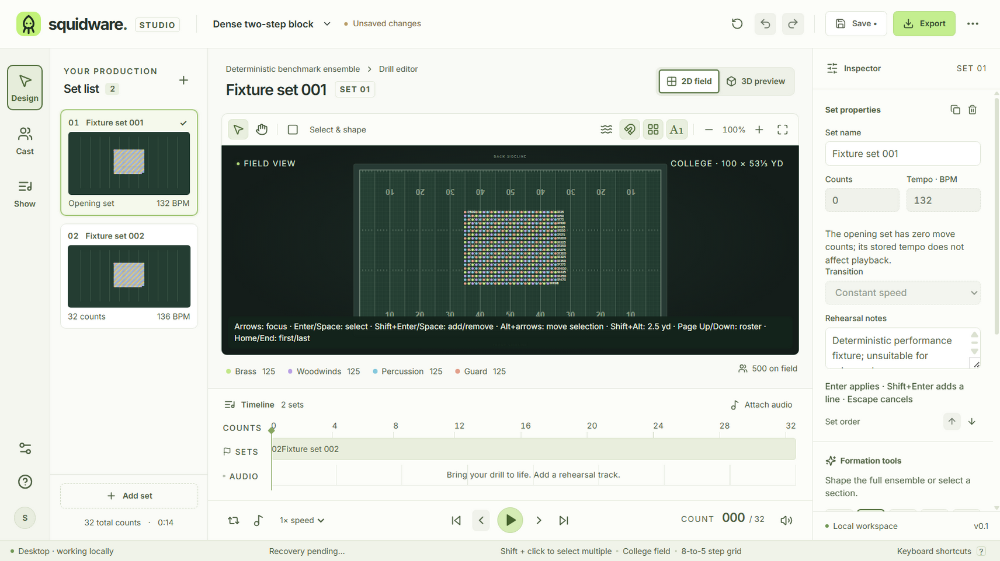
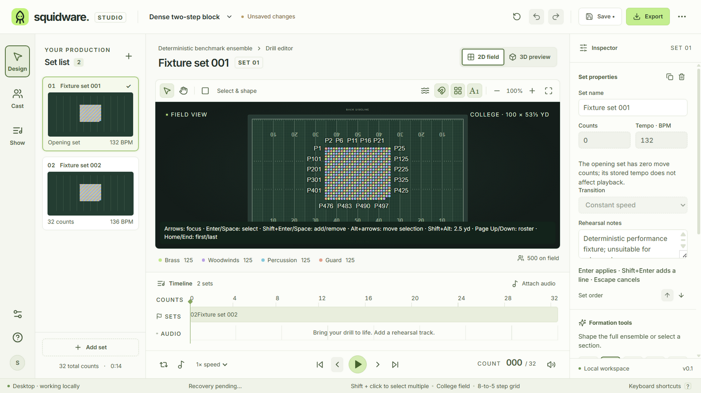

# Dense-field selection and labels

The interactive 2D field uses CSS pixels for presentation: 6 px dots, a 10 px mouse/pen hit radius, a 22 px touch hit radius and 12 px labels. SVG screen transforms account for zoom, resizing, display scaling and device pixel ratio. These values never change positions in yards. `FieldPresentation` is the shared input for future display preferences; persisted size and label controls remain owned by #42 and the existing #39 preference store.

Clicks and taps choose the nearest eligible center, regardless of SVG or roster order. Equal-distance ties (within floating-point tolerance) start in stable performer-ID order. Repeat presses within 3 CSS pixels cycle those tied IDs; moving a dot, changing the view/set or using a different target resets the cycle. This also works for completely coincident performers. Shift still adds/removes selection. Dragging starts after 3 CSS pixels with a mouse/pen or 8 pixels with touch, avoiding accidental edits from tap jitter. Pan, selection boxes, preview cancellation and one-command group moves retain their existing behavior. Hover readouts use the same nearest-center rule.

Labels try right, left, above and below, avoiding other labels, dot centers and viewport clipping. Keyboard focus has first priority, selection second, then stable IDs. A label with no free position is suppressed; focus or select the dot for its full identity and coordinates in the existing readout. This includes labels too long to fit. The toolbar's existing label button cycles **all → selected/focused → hidden**. Selected/focused mode is session state; the existing label visibility preference retains its previous persistence behavior. There is no additional preference store or project-format field.

The field retains its single roving Tab stop, distinct square focus outline, spatial arrows, Page Up/Down roster traversal (including coincidences), Enter/Space selection and modifier nudges. Presentation inputs apply to the interactive drawing. Static diagrams and print retain their existing yard-based sizes and complete labels; coordinate exports and saved project geometry are unaffected.

## Repeatable verification

Run `pnpm test`, `pnpm build`, then `pnpm test:field`. The new production-renderer check uses an isolated hidden Electron window and a 500-performer fixture at two-step (1.25-yard) intervals. It exercises every distinct center in an 8×8 block with Chromium mouse input, zoom limits, reversed roster order, coincident-dot cycling, Chromium touch input, hover feedback, keyboard label controls, 2× device scale, 125% UI zoom and a narrow window. It measures actual SVG label bounds and sizes and writes screenshots/results to `.qa/field-presentation`. `--baseline` captures the currently built app without running assertions. The accessibility suite owns roving keyboard focus and single-Tab-stop coverage. Source tests cover all 500 centers at four scales, tie ordering, target radii, label priorities/collisions and unchanged print geometry/project/coordinate output.

The shared [design guidance](DESIGN_GUIDANCE.md) sections 2–5 apply: reuse section colors, selection/focus geometry, the existing toolbar/help controls, the field readout and command/undo paths. The light editor chrome remains the currently implemented theme; dark/high-contrast switching and persisted UI scaling belong to #43. Chrome size and panel layout are unchanged here, with compact-layout targets still owned by #16/#40. Source and emulated-input checks do not establish physical touchscreen, assistive-technology or all-platform acceptance; writer/platform and school-hardware qualification remain tracked by #64/#3.

## Visual evidence

Same two-step block and nominal 1366 × 768 window at the current default UI scale. The Windows run measured a 1368 × 768 CSS-pixel viewport at 1.25 device scale (native window/DPI rounding), with a 787.4 × 284.2 px field. The field remains below the guide's approximately 470 px compact-layout target; that existing gap is owned by #16/#40. The images capture the existing light chrome; the field's colors are retained. The narrow check requests 1024 px, but respects the application's existing native minimum window width rather than claiming a 1024 px viewport.

Before (main at `83cfe624`):

After:

