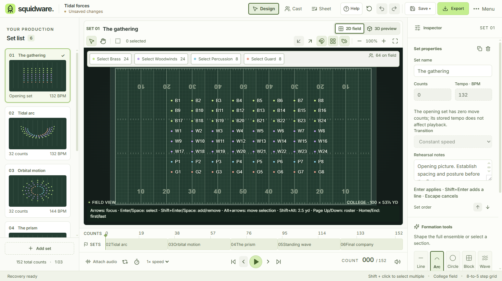
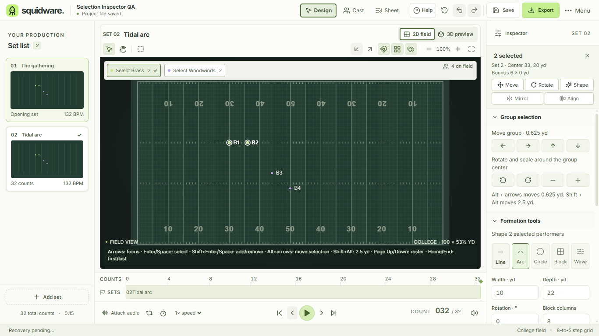

# Selection actions and contextual Inspector

Implements the workspace scope of [#18](https://github.com/IanSzymanski/squidware/issues/18). The selection bar stays above the Inspector's scrolling sections, preserving the compact field layout from #16.

- No selection: show an explicit Select all action and explain that dots or a section must be selected before editing. Apply formation never falls back to the ensemble.
- One performer: show its label and X/Y coordinates, exact coordinate inputs and movement controls. Rotation requires a group.
- Group: show the arithmetic center and the width/depth of its axis-aligned bounds, in yards. Move, rotate and scale use the existing shared transform command and field-boundary policy.
- Move, Rotate and Shape reveal the relevant section and transfer keyboard focus to its controls. Shape parameters and the explicitly scoped Apply formation action stay together.
- Between sets or during playback: label the summary with its source set, disable positional edits, and offer Return to this set to edit. The existing live field readout remains the authority for sampled preview positions.

Mirror and Align are discoverable, focusable disabled actions with an availability explanation. Their geometry and exact controls remain owned by #27 and #79. Formation previews, handles and Apply/Cancel remain #25; this issue retains the existing immediate, undoable formation command.

## Section state and drafts

Performer/group selection, Formation tools, Set properties and Transition check use native keyboard-operable disclosure controls. Four validated boolean personal preferences remember expansion through restart and reset with other personal settings. Older preferences receive defaults: selection and set properties open, formation and transition checks closed. They never enter `.squid` project data or change its saved revision.

Closing a disclosure keeps its fields mounted. Selection changes preserve unrelated formation and set drafts, including invalid input and its pending-save state. Exact performer input follows the selected performer; set drafts follow their set/project identity. Formation inputs retain the established validation and named undo behavior.

## Review and validation

Shared [design guidance](DESIGN_GUIDANCE.md) sections 1–5 apply. Reuses the existing Inspector/control styles, Lucide glyphs, HelpButton/Tooltip, NumberField, CommitInput, preferences persistence, selection and edit-lock state, and typed transform/formation commands. No new physical-coordinate convention or project-format change.

Evidence in `docs/evidence/selection-inspector` records the previous layout, empty/single/group states, read-only preview, and 1366/1120 × 768 windows at 100/125% display zoom. The fixed bar uses Inspector space; the field retains the compact layout's ≥470 px height target at 1366 × 768/default scale. Native pointer and Tab/Enter paths cover section selection, movement, rotation, explicit formation scope, one-step undo, draft preservation, disabled explanations and preview recovery. The preferences workflow checks disclosure choices in a fresh desktop process and project immutability; the accessibility and tooltip owners retain their existing checks.

Source, native-boundary and published-contract tests plus the production build are required. Desktop results are recorded with the implementation PR. Light chrome is the only currently implemented theme; dark/high contrast and configurable UI scaling remain #43. Writer/assistive-technology validation and school hardware qualification remain #64/#3.

Local Windows verification: build, 230 source tests, 41 native/harness tests, 16 published-contract tests, and the editor, tooltips, accessibility, preferences, thumbnails and playback desktop suites passed. [Measurements](evidence/selection-inspector/selection-measurements.json) show 485 px of field height at 1366 × 768/default scale and no clipped selection actions across the four tested window/zoom combinations. Hosted platform results belong to the PR.

| Before | Group selection after |
| --- | --- |
|  |  |

Additional inspected states: [empty](evidence/selection-inspector/selection-empty.png), [single performer](evidence/selection-inspector/selection-single.png), [preview](evidence/selection-inspector/selection-preview.png), [1120 px](evidence/selection-inspector/selection-group-1120-1.png), [125%](evidence/selection-inspector/selection-group-1366-1.25.png), [narrow at 125%](evidence/selection-inspector/selection-group-1120-1.25.png).
