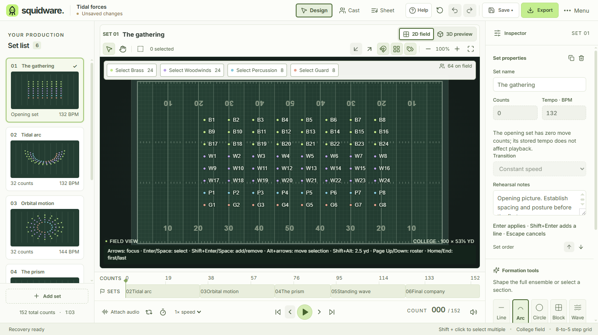
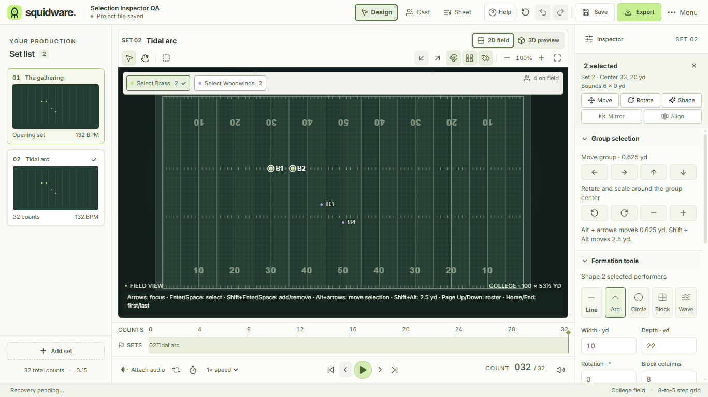

# Selection actions and contextual Inspector

Implements the workspace scope of [#18](https://github.com/IanSzymanski/squidware/issues/18). The selection header stays above the Inspector's scrolling sections. Since the shell rebuild, the actions that used to sit in a selection bar (Move, Rotate, Shape, Mirror, Align and Place) are tools in the tool strip above the field, and the Inspector shows the selection and the set as numbers.

- No selection: the header shows **0 selected**, the cast size and **Select all**, and the section chips select a section. The field's hint line says to select a dot, a box or a section first. A shape never falls back to the ensemble.
- One performer: the header shows its label and name. The **Position** section shows its coordinate in drill language, the move into the set (counts, travel and step size), **Move** buttons, and **Exact position** with X/Y inputs. Rotate and Scale require a group.
- Group: the **Selection** section shows the center in drill language and the **Size** of its axis-aligned bounds in steps (the surface's unit on a floor or stage), with the longest path and biggest step into the set. **Move** uses the shared nudge command. **Rotate** and **Scale** open the exact transform preview with the preset step. On the field, the selection frame's handles rotate and scale in place as one undoable edit.
- A shape, transform, spacing or coordinate preview puts its parameters at the top of the Inspector in place of the set and selection sections until it ends. **Apply** and **Cancel** are in the tool strip.
- Between sets or during playback: positional edits are unavailable and say why, and the tool strip offers **Edit set N**. The live field readout remains the authority for sampled preview positions.

Mirror opens the [exact transform preview](EXACT_TRANSFORMS.md) from #27. Align opens [spacing and alignment](SPACING_ALIGNMENT.md) for at least two selected performers, including exact intervals and even distribution. Formation controls use their own preview and field handles; each accepted operation is one named undo action.

Place opens [drill-language coordinate entry](COORDINATE_ENTRY.md): absolute placement for one performer or an exact relative move for the explicit selection. Side and unit choices are visible, proposed positions have field paths/crosshairs, and Apply/Cancel are in the tool strip.

## Section state and drafts

The **Selection** (or **Position**), **Set N details** and **Move check** sections use native keyboard-operable disclosure controls. Validated boolean personal preferences remember expansion through restart and reset with other personal settings. Older preferences receive defaults: selection and set details open, move check closed. They never enter `.squid` project data or change its saved revision.

Closing a disclosure keeps its fields mounted. Selection changes preserve unrelated formation and set drafts, including invalid input and its pending-save state. Exact performer input follows the selected performer; set drafts follow their set/project identity. Formation inputs retain the established validation and named undo behavior.

## Review and validation

Shared [design guidance](DESIGN_GUIDANCE.md) sections 1–5 apply. Reuses the existing Inspector/control styles, Lucide glyphs, HelpButton/Tooltip, NumberField, CommitInput, preferences persistence, selection and edit-lock state, and typed transform/formation commands. No new physical-coordinate convention or project-format change.

Evidence in `docs/evidence/selection-inspector` records the previous layout, empty/single/group states, read-only preview, and 1366/1120 × 768 windows at 100/125% display zoom. The fixed bar uses Inspector space; the field retains the compact layout's ≥470 px height target at 1366 × 768/default scale. Native pointer and Tab/Enter paths cover section selection, movement, rotation, explicit formation scope, one-step undo, draft preservation, disabled explanations and preview recovery. The preferences workflow checks disclosure choices in a fresh desktop process and project immutability; the accessibility and tooltip owners retain their existing checks.

Source, native-boundary and published-contract tests plus the production build are required. Desktop results are recorded with the implementation PR. Light chrome is the only currently implemented theme; dark/high contrast and configurable UI scaling remain #43. Writer/assistive-technology validation and school hardware qualification remain #64/#3.

Local Windows verification: build, 230 source tests, 41 native/harness tests, 16 published-contract tests, and the editor, tooltips, accessibility, preferences, thumbnails and playback desktop suites passed. [Measurements](evidence/selection-inspector/selection-measurements.json) show 485 px of field height at 1366 × 768/default scale and no clipped selection actions across the four tested window/zoom combinations. Hosted platform results belong to the PR.

| Before | Group selection after |
| --- | --- |
|  |  |

Additional inspected states: [empty](evidence/selection-inspector/selection-empty.png), [single performer](evidence/selection-inspector/selection-single.png), [preview](evidence/selection-inspector/selection-preview.png), [1120 px](evidence/selection-inspector/selection-group-1120-1.png), [125%](evidence/selection-inspector/selection-group-1366-1.25.png), [narrow at 125%](evidence/selection-inspector/selection-group-1120-1.25.png).
