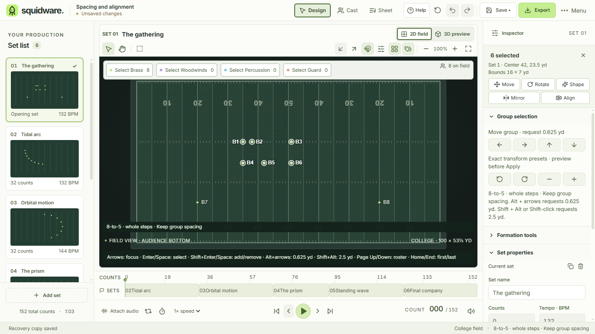
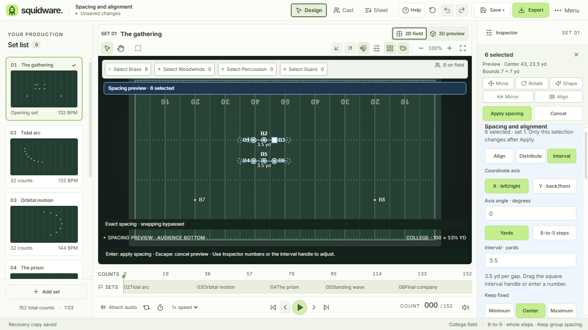

# Spacing guides, alignment and exact intervals

Implements [#79](https://github.com/IanSzymanski/squidware/issues/79). Select at least two performers, then choose **Align** in the selection bar. The Inspector and field preview share one evaluator for all proposed and accepted positions. Apply/Cancel remain above the scrolling controls.

## Axes, ordering and anchors

All axes use production coordinates, independent of audience orientation. **X · left/right** changes X while preserving Y. Aligning X makes a file. **Y · back/front** changes Y while preserving X; aligning Y makes a rank. An arbitrary axis angle is clockwise from X. For a rotated rank, use its angle to space along it, or its angle plus 90° to align onto it.

- **Align:** give every selected performer the same projected coordinate, at the original minimum, bounds midpoint, or maximum on the chosen axis. Perpendicular coordinates stay fixed.
- **Distribute:** use equal projected center-to-center gaps between the original minimum and maximum. Both extrema stay fixed. A zero-span group is unchanged.
- **Interval:** use the requested projected gap, keeping the original minimum, bounds midpoint, or maximum fixed. Units are yards or full marching steps at the production's 6/8/12-to-5 step size, independently of grid subdivision. Changing the displayed unit preserves the physical interval.

Order is ascending projected coordinate, then perpendicular coordinate, then performer ID. Coordinate sort keys use 1e-8-yard precision so mathematically tied rotated dots have stable ordering. Selection/roster order never silently reassigns dots. Coincident dots separate deterministically for positive intervals. Distribution of two dots is already even and therefore a no-op.

**Each rank/file** optionally divides distribution and interval edits into perpendicular-coordinate lanes. Points are sorted by perpendicular coordinate; each band includes points within the explicit tolerance of its first point, rather than chaining nearby pairs into an unlimited-width band. Default tolerance is 0.1 yard; supported range is 0–10 yards. Each lane has its own extrema and anchor. Singletons remain fixed. Align always uses the entire explicit selection; it does not apply lane grouping. For rotated blocks, choose the row angle for rows, or add 90° for files.

With grouping off, irregular rows are treated as one ordered group and can cross or overlap. Gaps are projected distances, not minimum Euclidean clearance. The preview shows the group count, singleton count and resulting gap range. Review the paths and transition checks before accepting. This tool does not perform assignment optimization or collision-free routing.

## Guides, numeric input and field handles

Dashed circles show original dots; dashed paths connect them to the proposed dots. Alignment uses a straight reference guide. Distribution/interval guides have a tick for each selected performer and a yard interval label. Labels remain upright with flipped audience orientation. Existing formation/transform previews must be applied or canceled before spacing begins, and spacing must finish before another position edit.

The square interval handle edits the largest lane (ties use the first lane) and changes the shared interval for all lanes. It uses the live SVG coordinate transform, including orientation, pan and field/display zoom. Minimum anchoring moves the last endpoint; maximum anchoring moves the first endpoint; midpoint anchoring expands both ends symmetrically. Pointer intervals resolve to six decimal places. Releasing a handle leaves the preview uncommitted. Escape during a drag restores the gesture's starting interval. Numeric interval entry provides the keyboard alternative.

Tab navigates the ordinary shared buttons and inputs; Enter/Space activates choices. Enter or blur validates a numeric draft and updates the preview. Escape inside a numeric field cancels that field draft. Enter on the field applies a valid changed preview, and Escape on the field or a non-input control cancels it. Handles add no extra field Tab stops.

## Bounds, scope and history

Exact spacing bypasses grid snapping. The field status states this explicitly. Boundary-crossing previews cannot Apply; the tool does not translate, shrink, or clamp a group to fit. Only floating-point noise within 1e-8 yard of an edge is normalized. Interval values must be positive and at most 1000 yards/steps; numeric entry and handles use a 0.001 minimum. Missing selections, invalid parameters, no-op geometry and pending input cannot Apply.

One Apply writes only the selected performers on the captured set, as one named undo action. Other performers, sets, performer identities and move paths remain unchanged. Undo/redo and native save/reopen preserve accepted coordinates. Previews do not change the project, history, file-save state, recovery geometry, or exports. No schema change is required; settings and guides are transient session state.

The session captures project revision, set ID and selection. A changed selection, set, playback position/state, workspace/view, dialog, transaction, loaded project or project revision invalidates it synchronously. Apply checks validity again. Changing audience orientation affects presentation while preserving the physical preview.

## Review evidence

Applies [design guidance](DESIGN_GUIDANCE.md) sections 1–5. Reuses the compact contextual Inspector, existing Align Lucide glyph, shared HelpButton/Tooltip, NumberField validation, field transforms, typed commands, edit locks and named history. The currently implemented light theme is covered; additional themes and UI scaling remain #43. Writer/assistive-technology and representative school-device checks remain #64/#3.

The 26 new source tests cover uneven and rotated lines, block rows/files, chained lane tolerance, tied/coincident positions, different step sizes, handle/numeric equivalence, invalid input, bounds, 500 performers, selection/current-set scope, cancellation, dirty state, stale sessions, undo/redo and format round trips. The production native `spacing` workflow owns actual pointer/Tab/Enter/Space controls, interval-handle dragging and Escape, numeric draft errors, boundary rejection, both orientations, named undo and native save/reopen. It is part of the shared Windows/macOS/Linux certification matrix.

The local Windows run passed 359 source tests, 17 contract tests and 51 native-boundary/harness tests, plus the spacing, editor, accessibility and tooltip desktop suites. Spacing scenarios include Tab/Enter/Space and interval dragging on a flipped field at 160% field zoom. [Layout measurements](evidence/spacing/results.json) show unchanged field height before and during previews: 485 CSS px at 1366×768/default scale, and 305.4 CSS px (381.75 physical px) at 1120×768/125%. Apply/Cancel remain in the visible selection bar, and numeric controls remain reachable by Inspector scrolling. No issue-specific field-height deviation was introduced. Hosted certification results belong to the implementation PR.

| Before the operation | Exact interval preview |
| --- | --- |
|  |  |

Also inspected: [alignment](evidence/spacing/spacing-align.png), [even distribution](evidence/spacing/spacing-distribute.png), [boundary rejection](evidence/spacing/spacing-boundary.png), [narrow/125%](evidence/spacing/spacing-1120-1.25.png), and [flipped orientation](evidence/spacing/spacing-flipped.png).
