# The rebuilt interface: what changed and why

Squidware's features were built first and its interface was assembled around them as they arrived. This change replaces that interface with a new application shell and a design system. The store, commands, drill math, analysis and file handling are unchanged; every old shell component and stylesheet is gone.

The brief for the rebuild was short:

- built on real drill-writing workflows, not on the feature list;
- what is always needed is always in reach, and deeper features are easy to find;
- easy to pick up and not intimidating, and easy to start writing drill;
- no screen space spent on things that do not matter while the important things are small.

This page shows the result next to what it replaced, explains the main decisions, and describes how an independent review loop and the regression suites shaped it.

## Before and after

All screenshots use the bundled Tether demo (165 performers, 67 sets) in the dark theme. The 1440 × 900 pair comes from a browser window on the same build machine; the 1600 × 1000 pairs come from the production desktop app and are the same scenes as the README screenshots before and after.

### Writing drill

| Before | After |
| --- | --- |
| 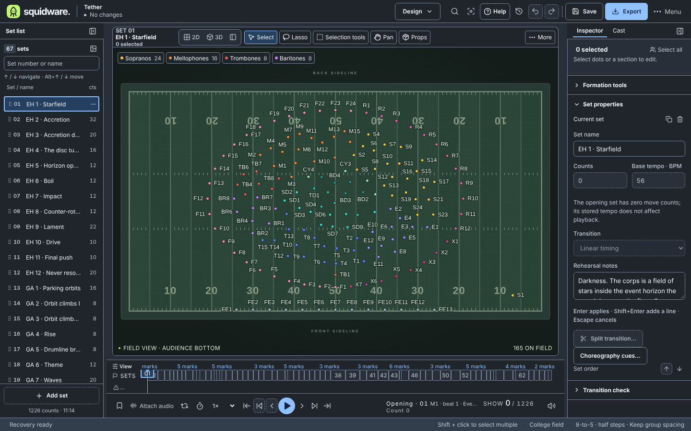 | 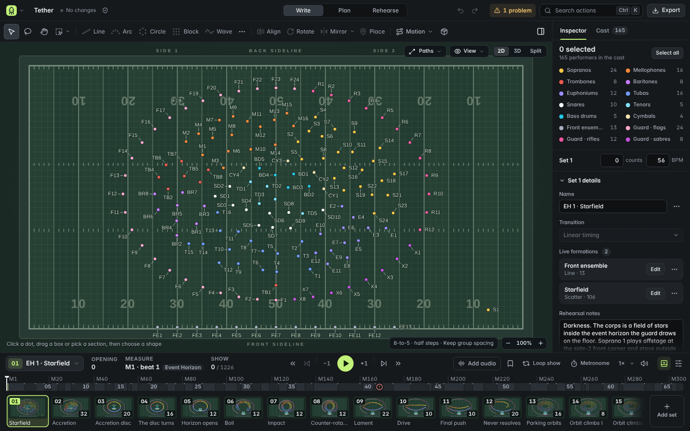 |

- **The field gets the window.** The turf goes from about 34% of a 1440 × 900 window to about 44%. The set list no longer takes a column: sets are a strip of thumbnails under the transport, and **Find set** reaches any set by number or name.
- **The drill verbs are buttons.** Select, Lasso and Pan, then Line, Arc, Circle, Block and Wave, then Align, Rotate, Mirror and Place sit in one labeled strip that never rearranges. Before, shaping and arranging were buttons inside the Inspector that appeared once something was selected, above a collapsed "Formation tools" section.
- **Depth is one named step away.** Motion, More shapes, Select, View, Paths, Timeline options and the Project menu hold the deeper features, and every command is in the Command palette.
- **Every section is in view.** The old row of section chips above the chart showed a handful of the fourteen sections and scrolled sideways. The side panel now lists every section with its color and count, and each name selects its section.
- **Problems are visible while writing.** A count in the top bar, markers on the timeline and badges on set thumbnails. Before, checks sat in a collapsed "Transition check" section at the bottom of the Inspector.

### A selection

| Before | After |
| --- | --- |
| 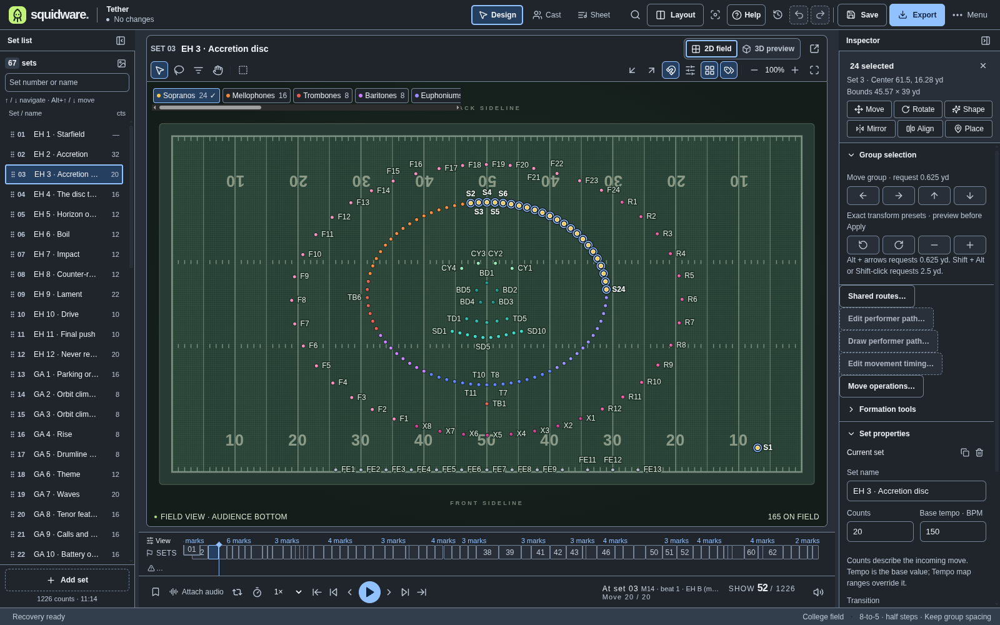 | 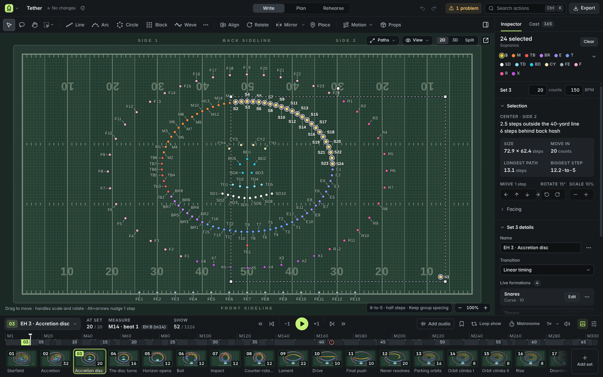 |

- **The selection is described the way a writer says it.** Before: "Center 61.5, 16.28 yd" and "Bounds 45.57 × 39 yd". After: "2.5 steps outside the 40-yard line, 6 steps behind back hash", its size in steps, the counts of the move in, the longest path and the biggest step.
- **Direct manipulation.** A multiple selection gets a frame whose handles rotate and scale it in place. The drag previews with the same arithmetic the edit uses and applies on release as one undo step. Nothing else in the window changes while it runs.
- **The side panel reallocates.** With a selection, the section list folds to a row of colors with their label prefixes, so the selection and the set have the panel.

### Planning counts and tempo

| Before | After |
| --- | --- |
| 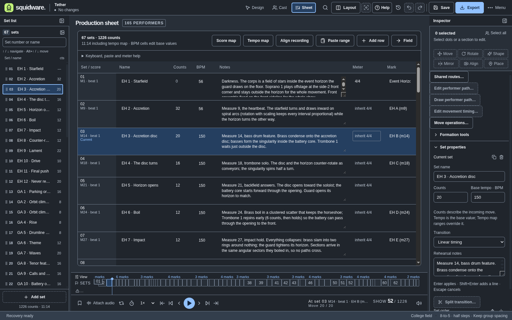 | 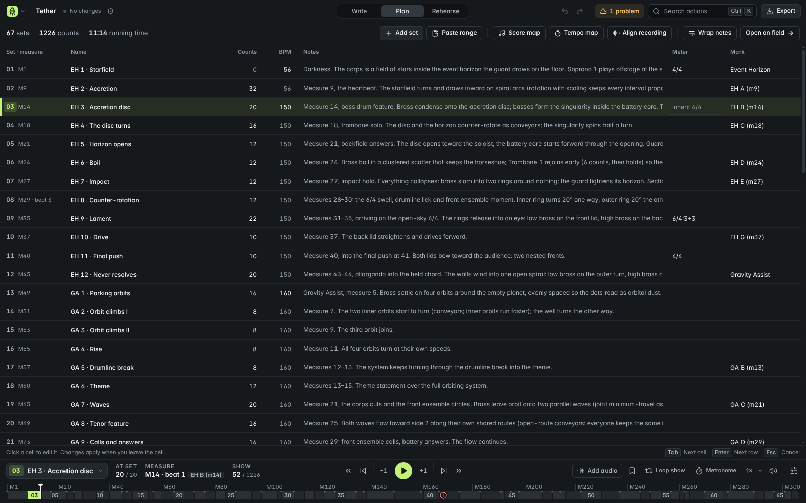 |

Plan is its own mode. The sheet has the whole window, one line of totals (sets, counts, running time), and its tools (Add set, Paste range, Score map, Tempo map, Align recording) in one row above it.

### Rehearsing in 3D

| Before | After |
| --- | --- |
| 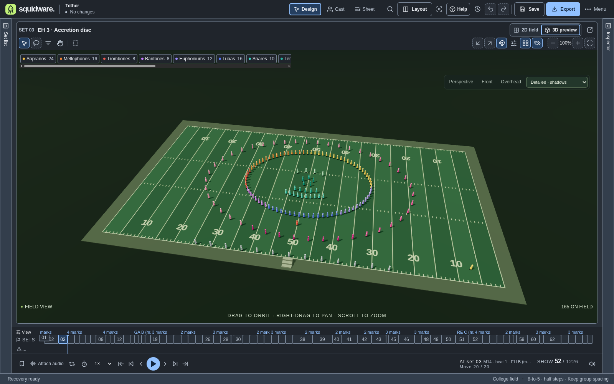 | 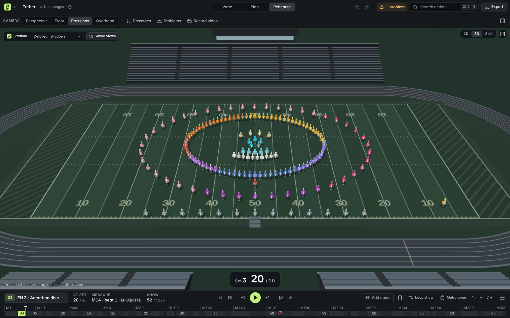 |

Each camera now frames the performers, the marchers are larger stylized figures, and the stadium gives the view a horizon. A large set-and-count readout serves the person at the back of the room.

### Editing one performer's path

| Before | After |
| --- | --- |
| 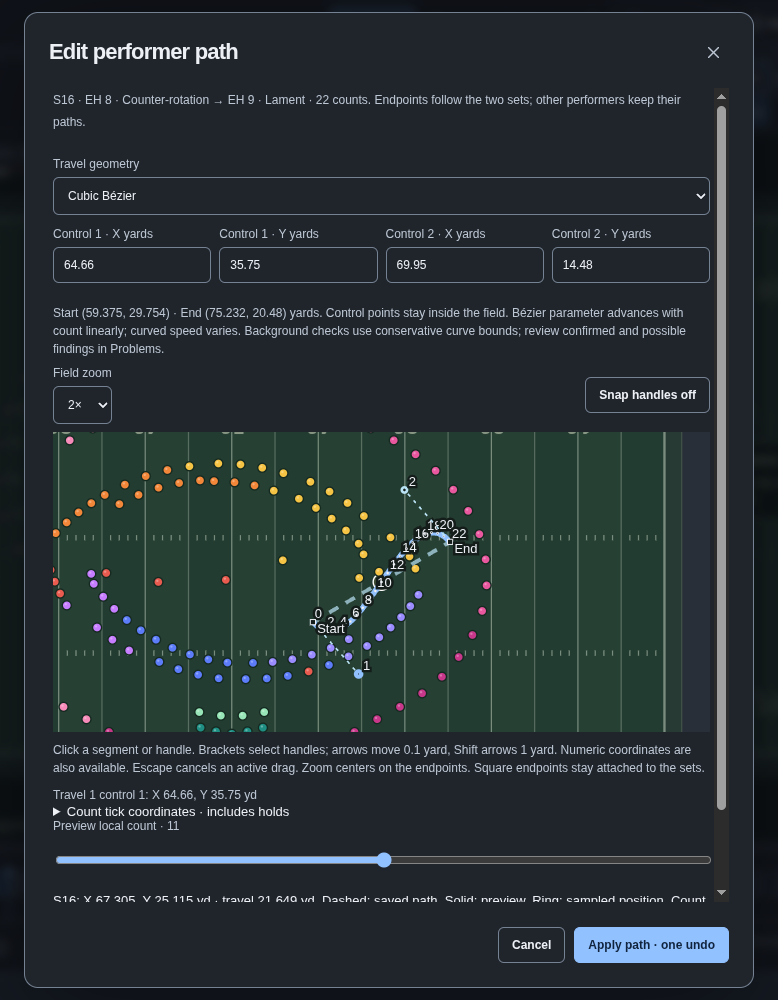 | 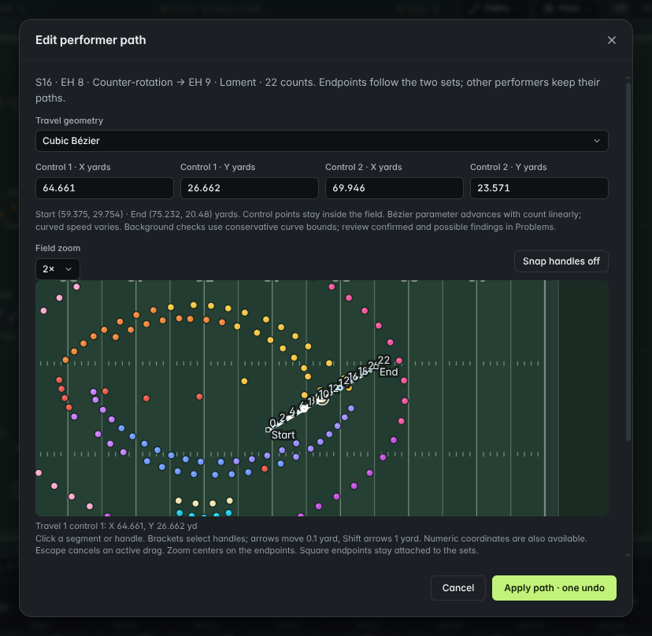 |

### Exporting a portable production

| Before | After |
| --- | --- |
| 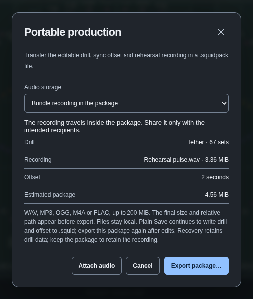 | 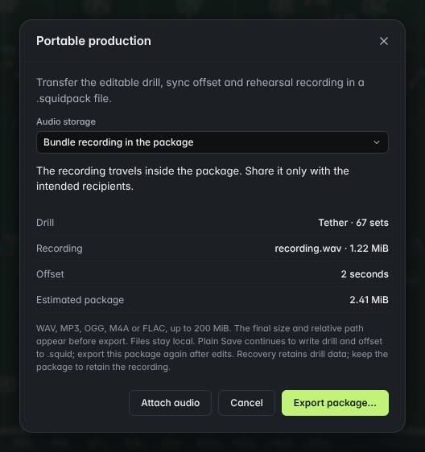 |

Dialogs share one layout: a sentence saying what will happen, the choices, a summary of the result, and one primary action.

## New in this shell

| | |
| --- | --- |
| 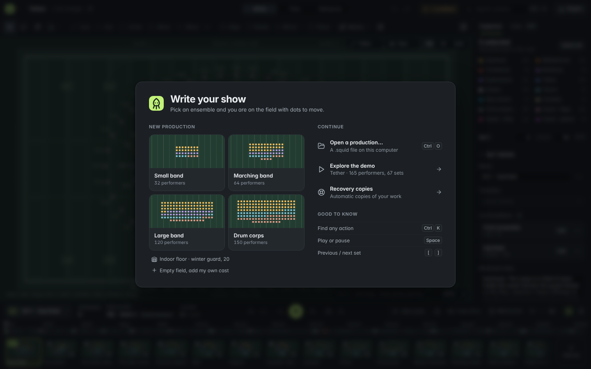 | **A place to start.** The start dialog offers a marching band, a drum corps and an indoor floor that open on a staging block ready to shape, plus Open and the demo. Before, the app opened straight into the demo. |
| 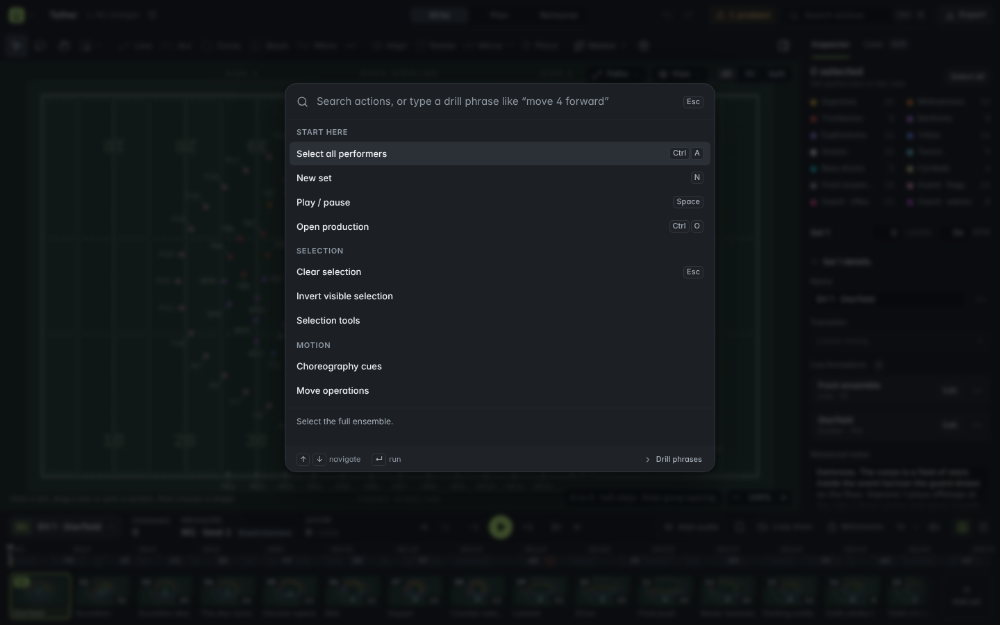 | **A palette that helps before you type.** It opens on what fits the current selection, then the available commands by group. Searching also finds commands that cannot run right now, each with its reason. |
| 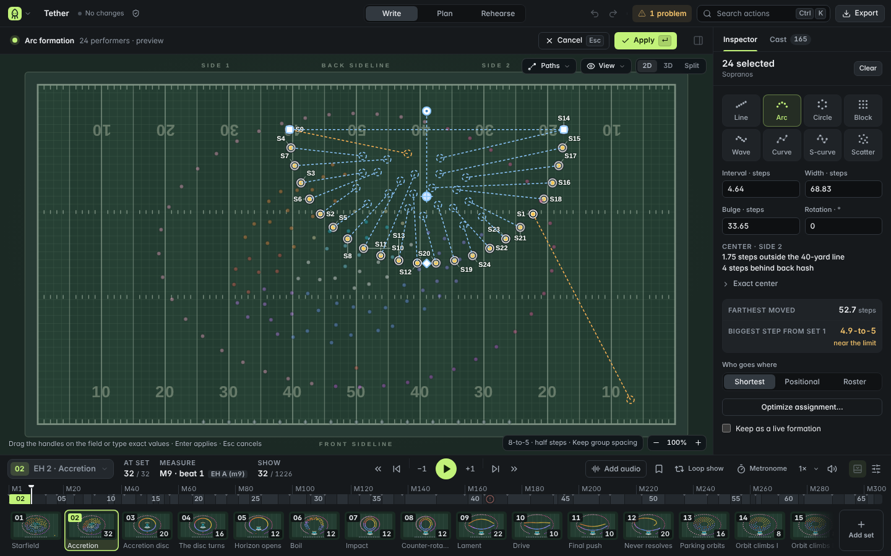 | **Shape previews in drill units.** A preview takes the tool strip with Cancel and Apply, its handles have a distinct glyph each, its lengths are in steps, and paths are colored where a step is near or over the stride limit. |
| 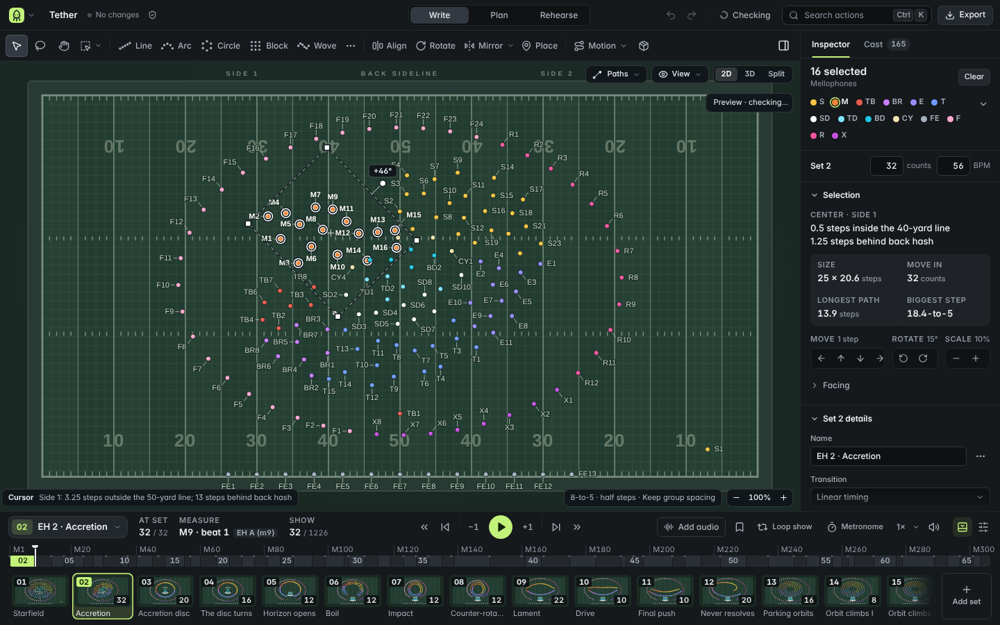 | **Rotate and scale on the field.** Whole degrees and whole percent, with Shift for 15° and 5% steps. Escape cancels. |
| 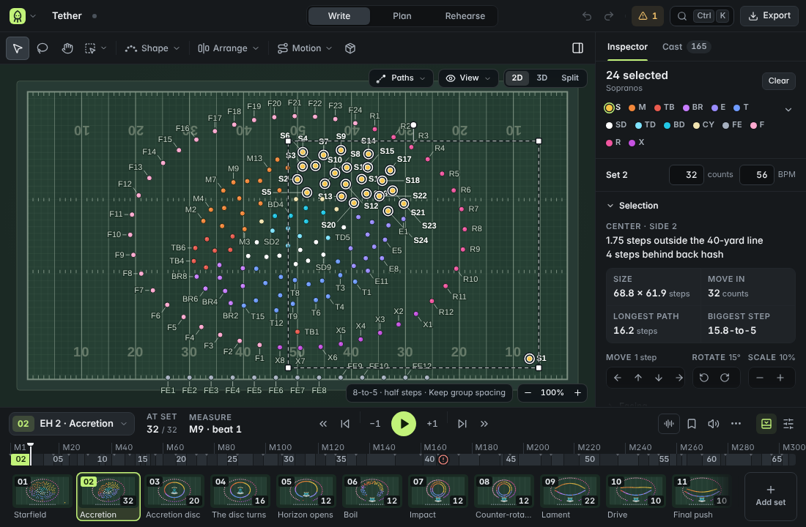 | **Small windows and large text.** Tools fold into Shape and Arrange menus, the side panel opens over the field when it cannot dock, and the transport folds its options into one menu. Every control stays reachable from 800 × 600 at 150% UI scale. |

## The design system

`src/ui/` holds the tokens (dark, light and high-contrast themes), base styles, shared controls, dialogs, a menu primitive and Squidware's own formation icons. `src/shell/` holds the shell. [The design system guide](DESIGN_SYSTEM.md) documents both, and [the workspace layout guide](WORKSPACE_LAYOUT.md) documents how the shell responds to window size and UI scale.

Two rules came from the project's own accessibility audit rather than from taste:

- All text is at least 11 px and at least 4.5:1 against its background, including on unavailable controls. An unavailable control uses a dedicated text color, a dimmed icon and a dashed outline instead of an opacity fade.
- Reduced motion means no transitions and no animations.

## How the review loop worked

The brief asked for the work to be judged by someone other than its author. After each round of changes, a separate reviewer agent with no access to the conversation or the code received a set of about twenty screenshots with neutral captions (what state is shown, never a claim about quality). It was asked to act as a working drill designer who also knows well-made professional software, to score each screenshot and the whole product, and to rank the problems with a concrete fix for each. The scale was fixed in advance: 5 is a developer look, 8.5 is polished and professionally vetted and holds up to real workflows, 10 could not be better. Each round used a fresh reviewer so that no score was anchored on the last one.

| Round | Score | What the reviewer ranked highest | Main changes that followed |
| --- | --- | --- | --- |
| 1 | 7.1 | The field had about a third of the window. The section key overlapped the field and was cut off. "All labels" left half the dots unnamed. Section colors were hard to tell apart on the turf. | The bottom dock was reduced and the fit margins tightened. The section key moved into the side panel. Label placement was rewritten: labels go to the side away from neighbors, selected performers are always named, and a displaced label gets a leader line. |
| 2 | 7.4 | The field was still small. A group selection had no handles on the field. Shape parameters were in yards with long decimals. A shape preview did not flag an oversized move. The 3D view was small in its frame and looked like developer art. | The selection frame with rotate and scale handles. Shape lengths in steps with an editable interval, and the center as a drill coordinate. Stride coloring in shape previews. Automatic camera framing, larger stylized marchers and a stadium in 3D. |
| 3 | 8.0 | Dragging a handle switched the whole window into a preview mode with engineering values. Split view wasted its panes. The side panel kept the full section list when something was selected. Chips collided with the field in small windows. Set numbering on the timeline was irregular. | Handle drags became non-modal: only an on-field readout, in whole degrees or percent. Split view stacks when the window is wide. The section list folds with a selection, with a scroll cue for what is below. Regular set numbering and measure ticks. |
| 4 | 7.8 | Split view still unresolved. Shape preview handles looked alike. The folded section row was color only. Adding a set was a four-option dialog. Mixed vocabulary. A regression: forced labels collided. | Distinct glyphs for end, bulge, rotate and center handles. Label prefixes in the folded section row. Add set opens on Hold. The label collision was fixed. |
| 5 | 8.0 | Floating chips over the front sideline. The single-performer state was not shown in the set. Set fields split the selection content in the side panel. Several nouns for the travel between sets. Split view defaults. The problems badge could read as a false all-clear. | The owner accepted 8.0 and stopped the loop here. Only the badge defect was fixed; the rest is listed below. |

The score dropped once, in round 4. A change that forced labels for every selected performer made them collide, and the reviewer caught it. That is the loop working as intended: the reviewer saw only the result.

What the review did not cover is anything a still image cannot show: tooltips, keyboard order, focus, behavior across window sizes and platforms. That is what the regression suites are for.

## What the regression suites added

The project's 51 desktop suites drive the production app through the real main process. Most of them addressed the old interface's elements, so each was ported to the new shell. A port keeps what the old check proved and re-targets it where a control was replaced: the workspace switcher became the three modes and the Workspaces dialog, the set-list pane became the set strip and **Find set**, and the header menu became the Project and View menus. One precondition was dropped with its two protections kept (in the analysis suite, closing Cast no longer changes the timeline's width, so that step moved to a narrower window).

Porting was worth more than a green run. The suites found defects in the new shell that no screenshot review would have, and all of them are fixed:

- **Reduced motion gave every element a transition.** The rule set a 1 ms duration on everything, which with the default transition property puts a transition on every property of every element: about 2,400 running at load, and a change only landed when a frame was drawn. On machines that report reduced motion, panel widths, the field's focus ring and label positions read their old values. This was behind most failures on Windows and macOS.
- **A show with many sections broke the side panel.** With 64 sections the list took all the height, the rest of the Inspector had none, and focusing a field below it scrolled the whole window.
- **Small windows and large UI scales.** The transport's audio control covered the play controls, the top bar's right side slid under the modes with a long title, and the 3D camera strip cut off the side panel's button.
- **Focus.** Closing a panel with the pointer showed the keyboard focus ring. A delayed focus hand-off could pull focus back after the next key press. The transport lost its focus hand-off when its options folded. Enter did not apply a scatter preview started from the palette.
- **A typeface assumption.** The shell was first verified on a machine with Inter installed. In the platform typeface most machines use, a palette description wrapped and moved the list under the pointer. The suites now also pass with Inter hidden.
- **Smaller ones.** The problems badge said "No problems" before the first whole-show check had run. Folded transport options were out of order. A notification sat off-center during its entrance. The audio row in the transport's menu was reduced to an icon.

## Defaults that changed

- Set thumbnails are on.
- The 3D view opens on the press-box camera with the stadium shown.
- The transport folds its options below 1000 px of main workspace width and moves passages and audio into its menu below 700 px (these were 800 and 520).
- Adding a set opens on **Hold positions**.

Print output and the on-field label typeface are unchanged.

## Known gaps

- From the last review round: chips can sit over labels at the front sideline in small windows; with a selection, the set's counts and tempo sit between the selection header and its details; the travel between two sets is called a move, a transition, a movement, a route and a path in different places; split view's default proportions.
- A notification can sit over the play controls in very short windows.
- An invalid draft left in a Write-mode field makes the production sheet refuse edits with a message about an input that Plan mode does not show.
- The suite table in [the testing guide](TESTING.md) still uses some of the old interface's vocabulary.
