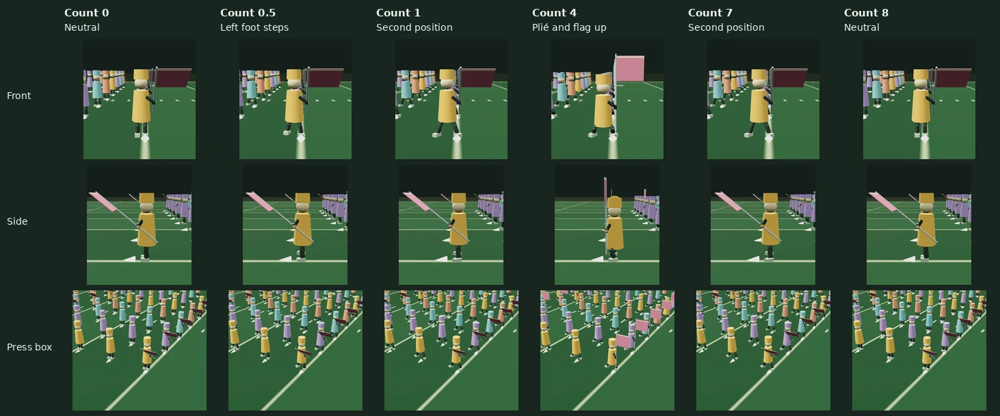

# Count-timed choreography

The [editor workflow](../../USER_GUIDE.md#choreography-cues) adds second position, plié in second position, and flag-up cues. The cue editor uses the current selection for additions. Editing retains a cue's explicit members unless the designer chooses **Use current selection**. A cue can be reviewed at its peak from the same dialog. Add, edit, and remove each use a named undo step.

## Pose and timing

Second position widens the stance by 0.16 yards per foot and turns each foot out from 10° to 45°. Plié opens into second position during the first half of its entry transition. The second half bends the knees in the direction of the toes and lowers the hips and torso by 0.04 to 0.14 yards. The shoe pivots keep their local positions and turnout through the bend, hold, and rise. The final half of the exit closes the feet to neutral. Articulation is illustrative and follows the authored performer root during travel.

For performers with authored flag cues, the carry pose pitches the pole 50° forward. Flag-up raises it to vertical, then returns it to carry. The pole and fabric rotate around the existing grip in the performer's facing frame. The sleeve, hand, and grip stay together through the body drop. Performers with no flag cues retain their static equipment pose. If a performer changes equipment after the cue was authored, the editor marks that member inactive and retains the cue for reassignment or later reuse.

The renderer samples envelopes from the same absolute show count as drill positions, then resolves each cue's move-local counts. Pause, reverse scrubbing, looping, and speed changes all use that same sample. Both transitions have the same count duration, leaving the remaining interval as the hold. An interval can touch the next one. Overlap for a performer within a track is rejected. Lower-body and flag tracks can run at the same time.

The [v15 format](../../../format/FORMAT.md#v15-choreography-cues) stores the move and endpoint IDs. Extending a move or trimming its uncued tail keeps each local count. Earlier timing edits can shift the cue's absolute count. Changing the anchored endpoints, removing a cued performer, or trimming past the cue's end rejects the whole edit until its cues have been adjusted or removed. Selection rings, authored coordinates, path timing, and clearance use the same production geometry. Lightweight 3D keeps the existing markers.

## Rendered and interaction review

- The [64-performer example](preview.webp) contains a stationary phrase and concurrent flag movement. The front view shows turnout and knee alignment. The side view shows the hip drop and pole angle. The press-box view shows group synchronization. The cues preserve the original skirt-like torso and simplified joints from the existing performer rigs.
- The [cue list](cue-list.webp) uses the shared dialog layout, selectors and actions. The [compact editor](cue-compact.webp) was checked at 670 px width with the 125% high-contrast UI. The keyboard goes to the preset when editing and can reach every field and action. This applies [design guidance §§1–4](../../DESIGN_GUIDANCE.md) through shared modal focus, native controls, visual rehearsal with the field in view, and explicit save/cancel and undo.
- The real editor replay checked mixed flag eligibility, both tracks, editing and removal, undo/redo, reviewing the peak count, and browser save/reopen. The native file tests cover v15 save/reopen and rejection before replacement. The routine exact-count checks use the sampler from a paused or scrubbed viewport and compare its rendered pixels.

## Software measurements

The demo uses 1366 × 768, the ensemble camera, 1× playback, and the same lightweight lighting for each measured case. The demo toggle switches articulated cues and flag tilt while keeping the flag models in both cases. The recorder measures browser frame intervals for about 3.2 seconds per case. The Linux host exposed three AMD EPYC 9V74 vCPUs under a two-CPU cgroup quota. Chromium 154 used ANGLE and SwiftShader. These measurements describe this host and allow comparison with the same fixture and quality setting.

Reproduce with `pnpm dev`, then run `node scripts/choreography-browser-qa.cjs` from the repository root with Playwright available. Set `SQUIDWARE_CHROMIUM` to point to a local Chromium binary. The script writes its raw captures and report to `.qa/choreography`.

| Cast | Poses | Draw calls | Triangles | Samples | Median frame interval | p95 |
| --- | --- | ---: | ---: | ---: | ---: | ---: |
| 64 | Static | 12 | 21,264 | 22 | 199.9 ms | 383.4 ms |
| 64 | Articulated | 13 | 26,384 | 17 | 200.0 ms | 533.2 ms |
| 500 | Static | 12 | 166,016 | 12 | 333.4 ms | 783.3 ms |
| 500 | Articulated | 13 | 206,016 | 12 | 383.3 ms | 583.2 ms |

The [raw browser report](browser-report.json) records the backend and interaction results.
