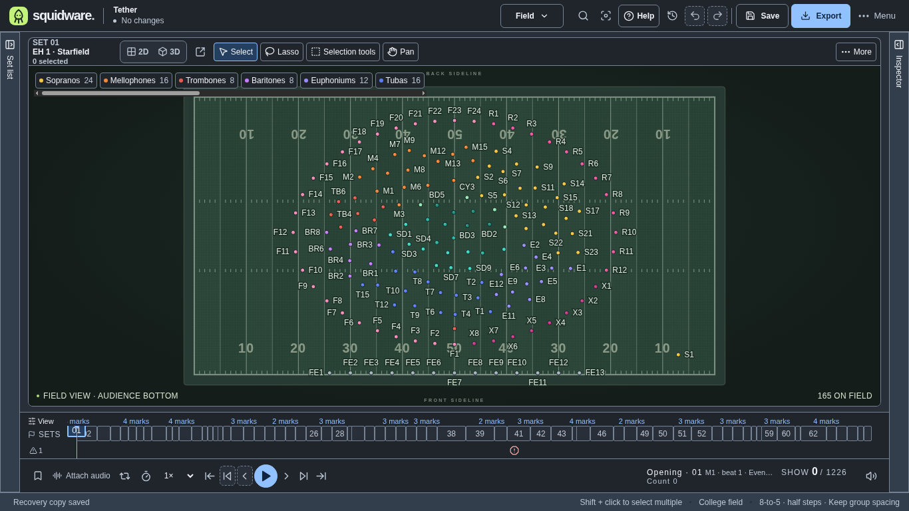

# Tether demo validation

Issue [#182](https://github.com/IanSzymanski/squidware/issues/182), November 16, 2026. The authored show, README images and user-guide walkthrough were already delivered on main. This pass fixes Explore the demo overwriting the show's analysis/placement settings with personal defaults and adds permanent certification of the actual bundled show.

The source suite passed **1,036 tests**, contracts **35**, and native services/harness **101**. The [desktop report](desktop-matrix.json) records **5/5** passing suites: demo-show, preferences, playback, audio-clock and audio-alignment. Reports identify the measured working tree before these evidence files were copied; they are targeted Linux evidence, not a completed cross-platform certification run. The default desktop suite registry includes demo-show in each platform's CI certification.

The [demo report](results.json) records all 67 native media seeks, playback readings from all four movements, and production worker analysis of all 66 moves with exactly one explained teaching finding. Personal analysis/placement defaults deliberately differ from the show's settings: blank productions inherit them, while Explore the demo retains the authored project and opens cleanly.

On this Linux software-rendering host, instrumented reload through a ready field and saved preferences took **675 ms**. Two seconds of actual 165-performer playback produced **120** frame samples: **16.7 ms median / 16.8 ms p95**, near the [16.7 ms investigation target](../../performance.md#fixtures-and-budgets). This measures frame cadence rather than main-thread CPU time; it is not a hardware performance guarantee or a cold-launch benchmark.

## Design review

The native screenshot was inspected against the shared design guidance: a 48 px header, readable section-colored performers, field controls beside the set name, visible Save/Undo/Export and transport, a collapsed unused side pane, and a **513 px field** at 1366 × 768 (above the 470 px target). The header says **No changes** for the untouched demo. No presentation changes were needed for this fix; production rules remain in the project while personal defaults remain in preferences.

No Space show recording ships with the app. The test generates silence locally and exercises the production media bridge and decoder. It verifies transport against the source score timing, not audible synchronization to an unavailable recording. See [example recording and redistribution notes](../../../examples/README.md).
