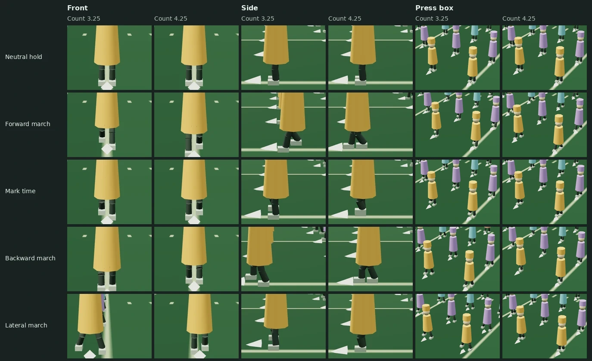

# Count-driven 3D leg motion

The [browser example](../../../examples/README.md#3d-leg-motion-prototype) is a read-only fixture for [issue #95](https://github.com/IanSzymanski/squidware/issues/95). It uses the existing Stage3D field, markers, and quality controls. It starts paused at count 3.25, with the side view of a 64-performer forward march. Turn off **Animate legs** to switch to the standard static legs at the current count and camera angle.

## Rig and timing

- Local axes use +X for the performer's right, +Y for up, and +Z for facing. The renderer translates by the sampled field position and rotates around +Y by the same facing used for the torso and heading marker. Equipment can attach in this performer-local space. The hip, knee, and ankle are joint positions in field yards, with left leg first. The shoe extends forward from the ankle along +Z.
- Phase is an absolute show count modulo two. The lookahead samples shared path positions 1/32 count ahead, bounded by show end. Projected travel gives fore/aft and lateral reach in the performer’s facing frame. Authored facing alone controls body orientation.
- Neutral hold uses the same pose at every count. Mark time is an explicit preview cue that lifts alternating feet on a stationary root. Scrub, pause, loop, and speed changes all use the same sampler.
- Future pose cues can supply local joint positions at a count and use the same transform. The rig batches thigh and shin segments together and uses a separate shoe batch. Geometry, field positions, and facings remain independent of the leg pose.

## Visual review

The side view makes forward and backward reach easiest to read. The front view makes alternating lift and lateral stance width easiest to read. The press-box angle shows cast timing and alignment. It gives less detail about individual knees and shoes.

The prototype uses stylized bending, a fixed stride reach, and no ground locking. The sliding is visible during forward and backward steps and most apparent in lateral steps. Shoes point with the torso, which makes sideways travel easy to distinguish from turning the body but approximates actual technique. Curved travel can change reach orientation within a beat. There is also a pose change where the lookahead crosses a hold boundary. These are useful motion sketches for later pose cues. The visuals support pose readability decisions only.

[Static markers](desktop-static.webp) and [articulated markers](desktop-animated.webp) show the same 1366 × 768 review layout. The field is 663 px high, with the transport visible. [Light](compact-light.webp) and [high-contrast](compact-high-contrast.webp) show the controls at 650 px width and 18 px root text. The prototype applies [design guidance §§1–4](../../DESIGN_GUIDANCE.md) through field priority, shared colors and control styles, the standard quality dropdown, labeled inputs and visible keyboard focus. There are no editable project records or saved preferences in the example.

The browser replay used keyboard Space to switch between rig and static markers and Home and Arrow Right to scrub. Neutral-hold renders matched across counts. Mark time changed the render at a fixed root. Pause froze both the count and the render. Playback wrapped at 2× with Loop enabled, stopped at the end with it disabled, and redrawing count 4 after playback matched the first scrub pixel for pixel. Source fixtures cover matching poses across speed and loop history, unknown facing, movement relative to facing, and matrix transforms. The fixture Project round-trips through the codec. Pose cues and the preview controls are transient, so there are no undo or project-save actions to check for them.

## Software measurement

[500 performers in the whole-ensemble view](ensemble-500.webp).

The Linux host exposed three AMD EPYC 9V74 vCPUs with a two-CPU cgroup quota. Headless Chromium 154 used ANGLE with SwiftShader Vulkan software rendering. The replay used the whole-ensemble camera at 1366 × 768, 663 px of field height, the lightweight quality preset, 1× playback, and a 4.5-second measurement window per case.

| Cast | Legs | Browser frame intervals | Median | p95 |
| --- | --- | ---: | ---: | ---: |
| 64 | Static | 25 | 166.7 ms | 349.9 ms |
| 64 | Articulated | 27 | 183.4 ms | 350.1 ms |
| 500 | Static | 15 | 250.0 ms | 650.0 ms |
| 500 | Articulated | 14 | 300.1 ms | 650.1 ms |

At 500 performers both modes were slow on this software renderer. Articulation adds one instanced draw batch and 40,000 leg triangles for that cast. These short samples describe playback cadence on this host. They do not establish hardware performance or isolate GPU time. The [raw browser report](browser-report.json) also records count-update intervals and main-thread script time.

To replay the checks and generate the captures, start `pnpm dev` and run `node scripts/leg-motion-browser-qa.cjs --measure` from the repository root with Playwright available to Node. Set `SQUIDWARE_CHROMIUM` to use a locally installed Chromium; otherwise the script uses Playwright's Chromium. The script writes PNGs and JSON to `.qa/leg-motion`. Run `pnpm exec vitest run src/components/legMotion.test.ts` for the source fixtures.
